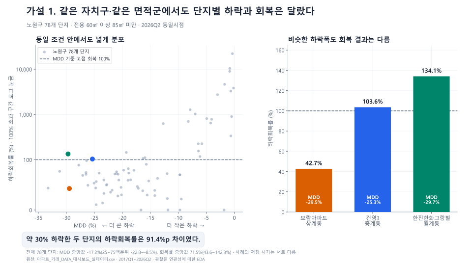
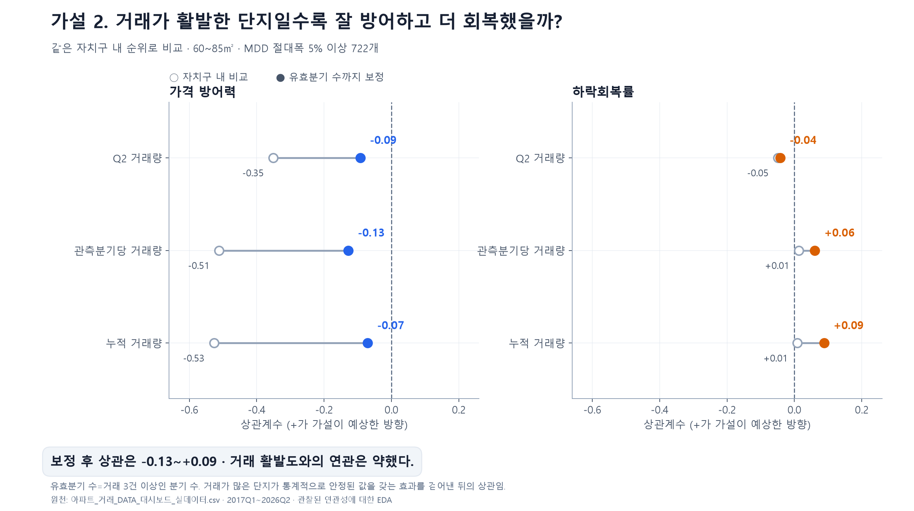
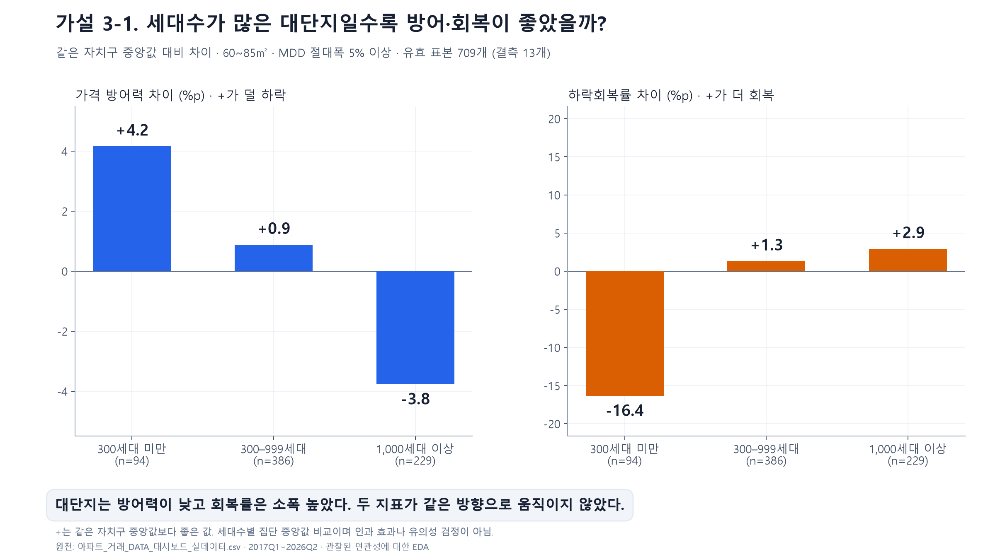
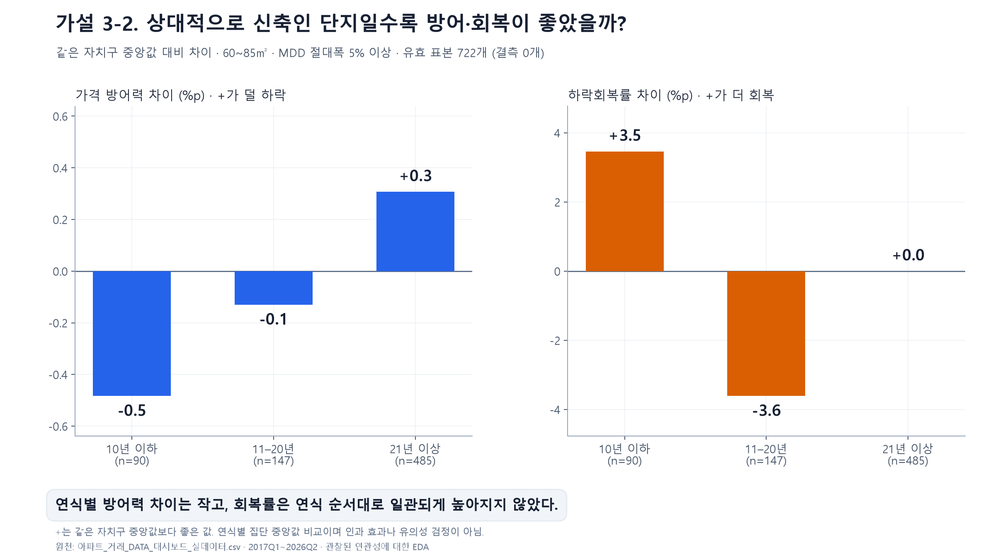
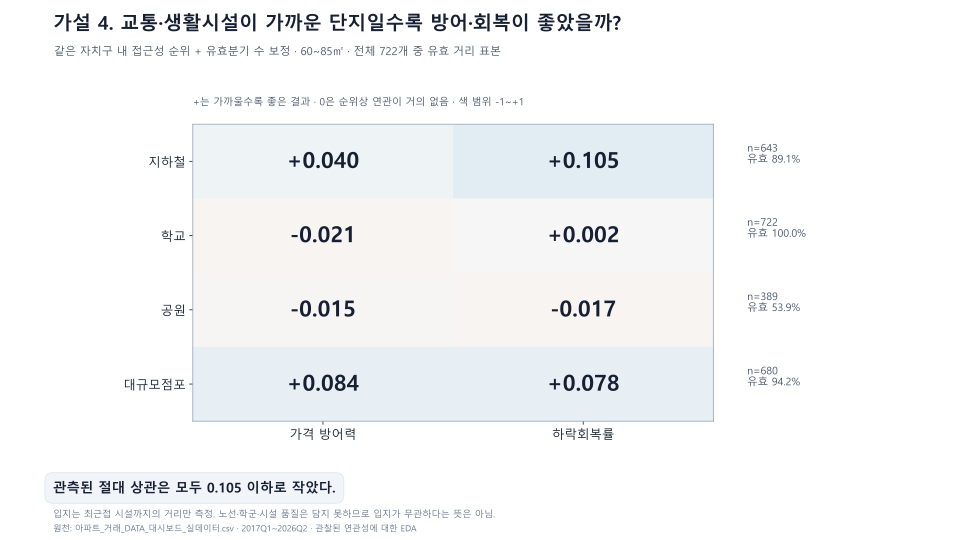
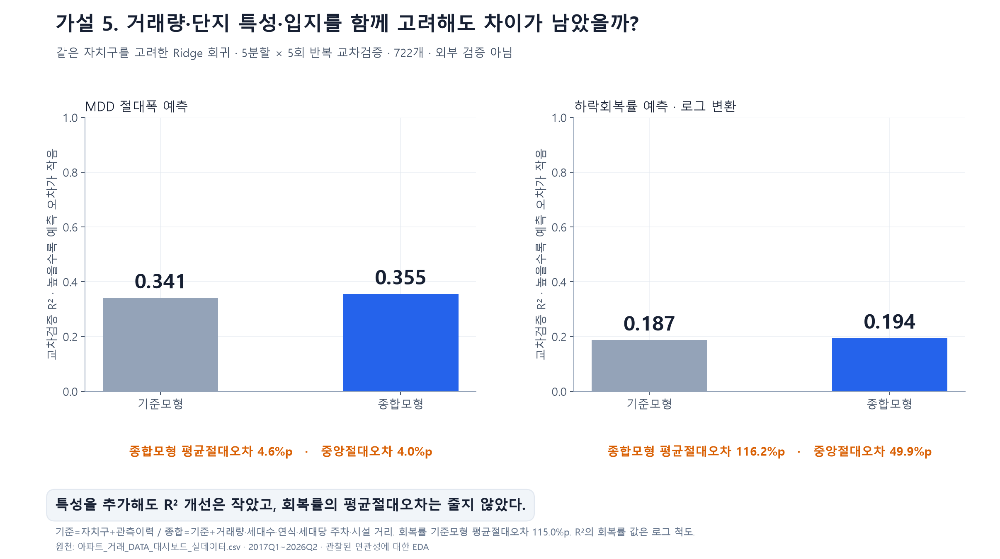

# 가설 1~5 · 장표에 바로 넣는 숫자

공통 조건 — 전용 60㎡ 이상 85㎡ 미만 · 기준시점 2026Q2 · 거래 3건 이상 완결 분기 4개 이상.
가설 1은 하락이 관측된 894개 단지, 가설 2~5는 MDD 절대폭 5% 이상 **722개** 표본.
아래는 모두 관찰된 연관성에 대한 EDA이며 인과 규명이나 미래 예측 검증이 아닙니다.

---

## 장표 1 — 같은 자치구·같은 면적군에서도 하락과 회복은 달랐다

**노원구 78개 단지 전체 분포**

| 지표 | 중앙값 | 25백분위 | 75백분위 |
| --- | --- | --- | --- |
| MDD (%) | -17.2% | -22.8% | -8.5% |
| 하락회복률 (%) | 71.5% | 43.6% | 142.3% |

**비슷한 낙폭, 다른 결과 (3개 사례)**

| 단지 | 법정동 | MDD | 하락회복률 | 고점 | 저점 |
| --- | --- | --- | --- | --- | --- |
| 보람아파트 | 상계동 | -29.5% | 42.7% | 2021Q3 | 2024Q1 |
| 건영3 | 중계동 | -25.3% | 103.6% | 2021Q2 | 2023Q1 |
| 한진한화그랑빌 | 월계동 | -29.7% | 134.1% | 2021Q3 | 2023Q1 |

- 낙폭이 사실상 같은 두 단지(보람아파트 -29.5% / 한진한화그랑빌 -29.7%)의 회복률 격차 **91.4%p**.
- 회복률 사분위 범위가 43.6~142.3%로 넓게 퍼져 있음.
- 단, 저점 시기가 서로 달라 회복에 주어진 기간도 다름.

> 전환 멘트 — "같은 자치구와 같은 면적군인데도 왜 이런 차이가 발생했을까요? 저희는 그 이유를 거래 유동성, 단지 특성, 입지환경의 세 가지 측면에서 살펴봤습니다."

---

## 장표 2 — 거래량만으로는 방어와 회복을 설명하기 어려웠다

| 거래지표 | 결과지표 | 자치구 내 상관 | 유효분기 수 보정 후 |
| --- | --- | --- | --- |
| Q2 거래량 | 가격 방어력 | -0.351 | **-0.092** |
| Q2 거래량 | 하락회복률 | -0.049 | **-0.042** |
| 관측분기당 거래량 | 가격 방어력 | -0.512 | **-0.128** |
| 관측분기당 거래량 | 하락회복률 | +0.013 | **+0.061** |
| 누적 거래량 | 가격 방어력 | -0.527 | **-0.070** |
| 누적 거래량 | 하락회복률 | +0.008 | **+0.088** |

- 보정 전 방어력 상관이 최대 -0.53까지 나오지만, 이는 거래가 많은 단지일수록 값이 안정되는 효과가 섞인 결과.
- 유효분기 수를 보정하면 상관은 **-0.128 ~ +0.088** 로 축소.
- 방어력과 회복률의 부호도 서로 엇갈려, "거래가 활발하면 둘 다 좋다"는 예상은 일관되게 확인되지 않음.

> 전환 멘트 — "거래 활발도만으로는 차이를 설명하기 어려웠습니다. 다음으로 단지의 규모와 연식을 봤습니다."

---

## 장표 3-1 — 대단지의 방어력과 회복률은 같은 방향이 아니었다

| 세대수 구간 | n | MDD 중앙값 | 회복률 중앙값 | 방어력(자치구 대비) | 회복률(자치구 대비) |
| --- | --- | --- | --- | --- | --- |
| 300세대 미만 | 94 | -13.7% | 75.2% | **+4.2%p** | **-16.4%p** |
| 300–999세대 | 386 | -17.5% | 145.3% | **+0.9%p** | **+1.3%p** |
| 1,000세대 이상 | 229 | -22.2% | 151.1% | **-3.8%p** | **+2.9%p** |

- 1,000세대 이상: 방어력 **-3.8%p**, 회복률 **+2.9%p** — 더 잘 버티지는 않았고 회복만 소폭 우위.
- 300세대 미만: 방어력 **+4.2%p**, 회복률 **-16.4%p** — 방향이 정반대.
- '대단지이면 덜 하락하고 더 회복한다'고 묶어서 판단하기 어려움.

## 장표 3-2 — 신축일수록 두 지표가 일관되게 좋지는 않았다

| 연식 구간 | n | MDD 중앙값 | 회복률 중앙값 | 방어력(자치구 대비) | 회복률(자치구 대비) |
| --- | --- | --- | --- | --- | --- |
| 10년 이하 | 90 | -20.5% | 163.9% | **-0.5%p** | **+3.5%p** |
| 11–20년 | 147 | -18.4% | 154.5% | **-0.1%p** | **-3.6%p** |
| 21년 이상 | 485 | -17.6% | 126.5% | **+0.3%p** | **+0.0%p** |

- 10년 이하: 방어력 **-0.5%p**, 회복률 **+3.5%p**.
- 연식이 오래될수록 나빠지는 단조 관계는 나타나지 않음(11~20년 회복률 -3.6%p, 21년 이상 +0.0%p).
- 연식 순서에 따른 일관된 방어·회복 우위는 확인되지 않음.

> 전환 멘트 — "규모와 연식에 이어, 같은 자치구 안에서도 달라지는 시설 접근성을 봤습니다."

---

## 장표 4 — 최근접 시설 거리와의 연관은 작았다

| 시설 | 유효 n | 유효비율 | 가격 방어력 상관 | 하락회복률 상관 |
| --- | --- | --- | --- | --- |
| 지하철 | 643 | 89.1% | +0.040 | +0.105 |
| 학교 | 722 | 100.0% | -0.021 | +0.002 |
| 공원 | 389 | 53.9% | -0.015 | -0.017 |
| 대규모점포 | 680 | 94.2% | +0.084 | +0.078 |

- 자치구와 유효분기 수를 함께 보정한 절대 상관 최대값 **0.105**.
- 거리 변수만으로는 단지별 차이를 설명하기 어려움.
- 입지가 중요하지 않다는 결론은 아님 — 거리는 노선·학군·시설 품질을 담지 못함.

> 전환 멘트 — "마지막으로 변수를 하나씩 보는 단계를 넘어, 여러 특성을 함께 넣어봤습니다."

---

## 장표 5 — 함께 고려해도 단지별 차이는 남았다

| 목표 | 기준모형 R² | 종합모형 R² | 개선폭 | 종합모형 평균절대오차 | 중앙절대오차 |
| --- | --- | --- | --- | --- | --- |
| MDD 절대폭 | 0.341 | 0.355 | +0.014 | 4.6%p | 4.0%p |
| 하락회복률(로그) | 0.187 | 0.194 | +0.007 | 116.2%p | 49.9%p |

- 기준모형 = 자치구 + 관측이력 / 종합모형 = 기준 + 거래량·세대수·연식·세대당 주차·시설 거리.
- 특성을 모두 넣어도 R² 개선은 MDD **+0.014**, 회복률 **+0.007** 에 그침.
- 회복률의 원래 단위 평균절대오차는 기준 115.0%p → 종합 116.2%p 로 **줄지 않음**.
- 종합모형으로도 MDD 예측이 **40%** 의 단지에서 5%p 넘게 빗나갔고, 회복률은 **49%** 의 단지에서 50%p 넘게 빗나감.
- 잔차에는 누락 요인·거래 잡음·모형 한계가 함께 포함됨. 단지 고유의 힘을 입증한 것은 아님.

---

## 마무리 멘트

> 같은 자치구·같은 면적군에서도 단지별 하락과 회복은 달랐습니다. 거래 유동성, 단지 특성, 입지환경을 차례로 살펴봤지만 몇 가지 특성만으로 모든 단지를 설명하기는 어려웠습니다. 그래서 자치구 평균만 보는 대신, 관심 단지의 가격 흐름과 MDD·하락회복률, 단지 특성을 직접 비교할 수 있는 서비스를 만들었습니다.
