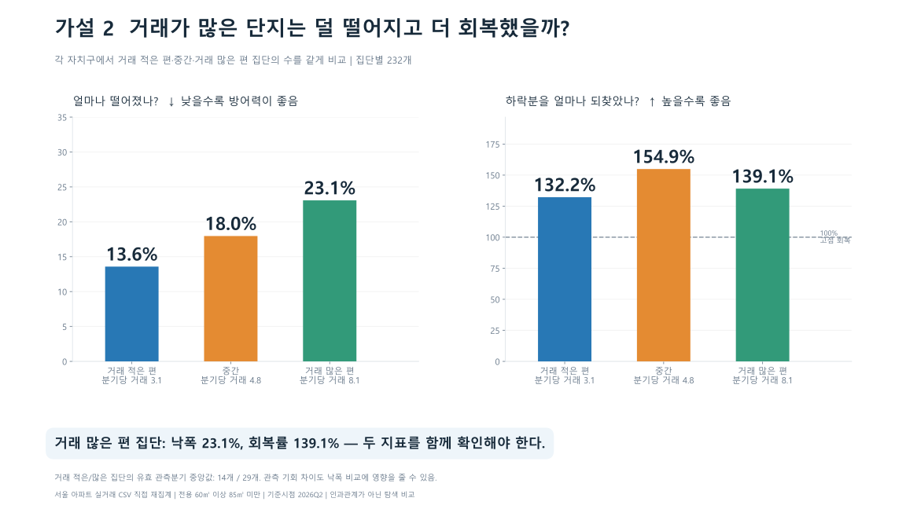
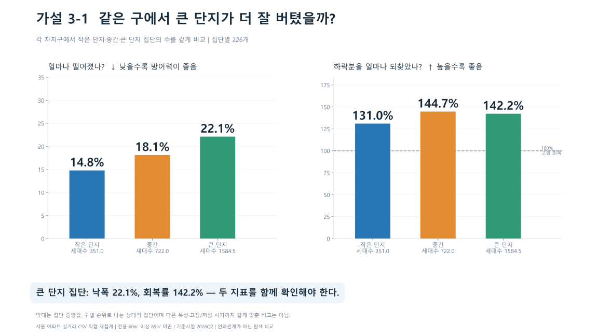
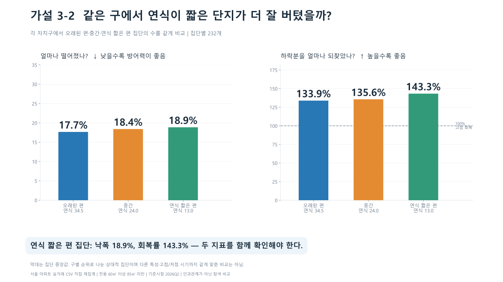
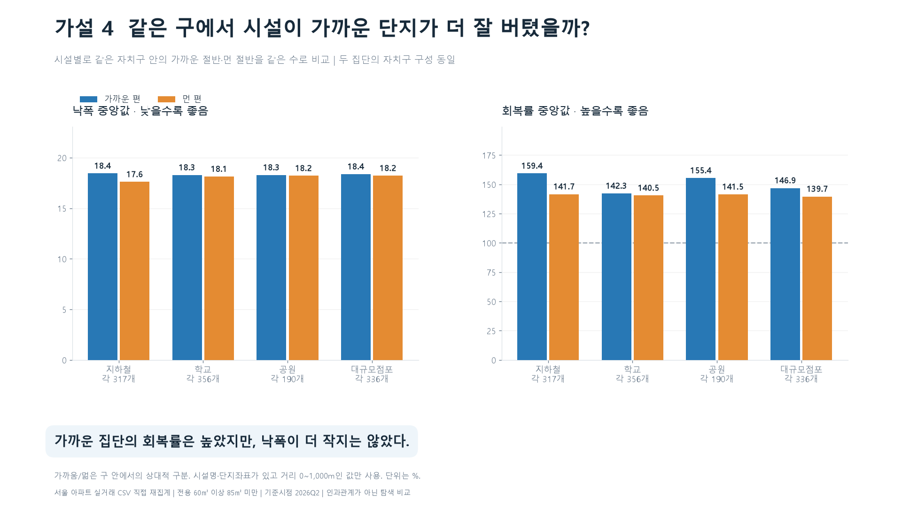
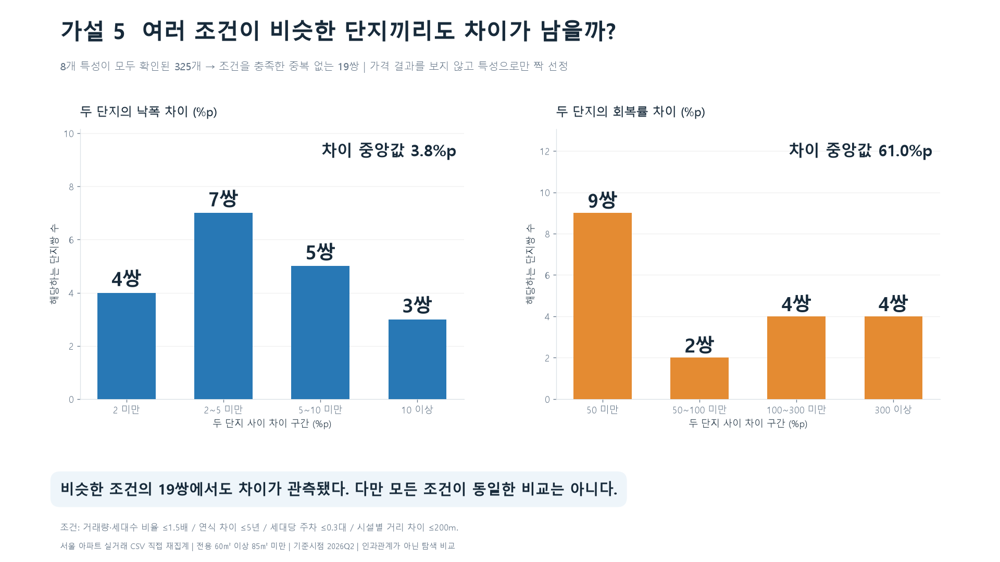

# 가설 2~5: 직관적 시각화와 장표용 숫자

## 공통 분석 기준

- 지정 CSV를 새로 읽어 거래 가격부터 재집계했다. 원천 거래 610,341건, 단지 8,963개. CSV·대시보드 파일은 변경하지 않았다.
- 분석·그래프 라이브러리는 pandas, NumPy, Matplotlib만 사용했다. 경로·해시·압축 등에는 파이썬 표준 라이브러리를 사용했다. 기존 대시보드의 동일 단지 식별·전처리 함수도 pandas·NumPy 기반이다. 회귀·머신러닝·외부 통계 라이브러리는 사용하지 않았다.
- 전용 **60㎡ 이상 85㎡ 미만**, **2026Q2** 기준. 가격은 거래금액/전용면적의 단지·분기 중앙값(만원/㎡). 거래 3건 이상인 완결 분기 4개 이상, Q2 거래 3건 이상. 연속 4분기라는 뜻은 아니다.
- 하락이 관측된 894개 중 **낙폭 5% 이상 722개**로 분석했다. 작은 낙폭에서 회복률 분모가 작아지는 문제를 줄이기 위한 탐색 조건이며 전체 시장의 대표 표본은 아니다.
- MDD 절대폭은 **작을수록 방어력이 좋음**. 음수 MDD -20%는 그림에서 낙폭 20%로 표현한다. 하락회복률은 (Q2가격-저점)/(MDD구간 고점-저점)×100. **100%는 그 고점 회복**, 150%는 하락분의 1.5배 회복이다. 상승률 150%나 빠른 회복을 뜻하지 않는다.
- 가설 2·3: 각 자치구에서 해당 특성으로 정렬하고 작은/중간/큰 집단에 같은 수를 배정했다. 각 집단은 floor(유효 단지수/3)개이고 나머지 최대 2개는 제외한다. 동률은 단지 ID로 순서를 정한다. 따라서 일부 경계 동률이 집단에 나뉠 수 있다. **집단별 자치구 구성은 같지만 다른 특성까지 같지는 않다.**
- 가설 4: 시설별로 각 구의 가까운 절반과 먼 절반에서 같은 수를 선택한다. 홀수일 때 가운데 1개는 제외한다. 같은 구 안에서 가까운 편이라는 뜻이지 절대적인 역세권 기준은 아니다.
- 막대는 집단 전체의 **중앙값**이다. 구별 효과를 추정한 회귀계수나 개별 단지의 순수한 특성 효과가 아니다. 구별 구성 균형을 맞췄더라도 구 내부의 교란이나 중앙값 집계의 한계는 남는다.
- 같은 면적군이지만 정확한 면적·층·동은 다를 수 있다. 고점·저점 시점, 회복에 주어진 시간도 다르다. 통계적 유의성·인과관계·미래 예측력을 검증한 자료가 아니다.

## 가설 2 — 거래가 활발한 단지일수록 더 잘 방어하고 회복할까?

| 집단 | 단지수 | 특성중앙값 | 낙폭중앙값(%) | 하락회복률중앙값(%) | 유효분기수중앙값 |
| --- | --- | --- | --- | --- | --- |
| 거래 적은 편 | 232 | 3.1 | 13.6 | 132.2 | 14.0 |
| 중간 | 232 | 4.8 | 18.0 | 154.9 | 21.0 |
| 거래 많은 편 | 232 | 8.1 | 23.1 | 139.1 | 29.0 |

특성중앙값 단위: **거래가 관측된 분기당 평균 거래수(건)**. 유효분기 수는 거래 3건 이상인 분기 수다.

**장표 핵심 숫자**

- 집단별 **232개**를 비교했다.
- 거래 적은 편: 낙폭 **13.6%**, 하락회복률 **132.2%**.
- 거래 많은 편: 낙폭 **23.1%**, 하락회복률 **139.1%**.
- 두 집단 간 차이(거래 많은 편-거래 적은 편): 낙폭 **+9.5%p**, 회복률 **+6.9%p**.

**발표 멘트:** “각 구에서 비교 집단의 수를 같게 맞춘 뒤 실제 낙폭과 회복률을 비교했습니다. 거래 적은 편의 낙폭과 회복률은 13.6%, 132.2%였고, 거래 많은 편은 23.1%, 139.1%였습니다. 두 지표가 예상 방향으로 함께 움직이지 않아, 이 특성만으로 방어·회복 모두 좋다고 판단하기 어렵다.”

**해석할 때:** 거래 활발도는 전체 거래수/거래가 한 번이라도 있는 관측분기 수다. 거래 없는 분기를 포함한 달력 평균은 아니다. 거래 기회가 많으면 하락을 포착할 기회도 많고, 신축은 관측 이력이 짧을 수 있다. 세대수·연식은 관리 품질이나 시장 선호도 자체를 직접 측정하지 않는다.

## 가설 3-1 — 세대수가 많은 단지일수록 더 잘 방어하고 회복할까?

| 집단 | 단지수 | 특성중앙값 | 낙폭중앙값(%) | 하락회복률중앙값(%) | 유효분기수중앙값 |
| --- | --- | --- | --- | --- | --- |
| 작은 단지 | 226 | 351.0 | 14.8 | 131.0 | 16.0 |
| 중간 | 226 | 722.0 | 18.1 | 144.7 | 22.0 |
| 큰 단지 | 226 | 1,584.5 | 22.1 | 142.2 | 27.0 |

특성중앙값 단위: **세대수(세대)**. 유효분기 수는 거래 3건 이상인 분기 수다.

**장표 핵심 숫자**

- 집단별 **226개**를 비교했다.
- 작은 단지: 낙폭 **14.8%**, 하락회복률 **131.0%**.
- 큰 단지: 낙폭 **22.1%**, 하락회복률 **142.2%**.
- 두 집단 간 차이(큰 단지-작은 단지): 낙폭 **+7.3%p**, 회복률 **+11.2%p**.

**발표 멘트:** “각 구에서 비교 집단의 수를 같게 맞춘 뒤 실제 낙폭과 회복률을 비교했습니다. 작은 단지의 낙폭과 회복률은 14.8%, 131.0%였고, 큰 단지은 22.1%, 142.2%였습니다. 두 지표가 예상 방향으로 함께 움직이지 않아, 이 특성만으로 방어·회복 모두 좋다고 판단하기 어렵다.”

**해석할 때:** 거래 활발도는 전체 거래수/거래가 한 번이라도 있는 관측분기 수다. 거래 없는 분기를 포함한 달력 평균은 아니다. 거래 기회가 많으면 하락을 포착할 기회도 많고, 신축은 관측 이력이 짧을 수 있다. 세대수·연식은 관리 품질이나 시장 선호도 자체를 직접 측정하지 않는다.

## 가설 3-2 — 신축에 가까운 단지일수록 더 잘 방어하고 회복할까?

| 집단 | 단지수 | 특성중앙값 | 낙폭중앙값(%) | 하락회복률중앙값(%) | 유효분기수중앙값 |
| --- | --- | --- | --- | --- | --- |
| 오래된 편 | 232 | 34.5 | 17.7 | 133.9 | 21.0 |
| 중간 | 232 | 24.0 | 18.4 | 135.6 | 22.0 |
| 연식 짧은 편 | 232 | 13.0 | 18.9 | 143.3 | 20.0 |

특성중앙값 단위: **연식(년, 2026-건축연도)**. 유효분기 수는 거래 3건 이상인 분기 수다.

**장표 핵심 숫자**

- 집단별 **232개**를 비교했다.
- 오래된 편: 낙폭 **17.7%**, 하락회복률 **133.9%**.
- 연식 짧은 편: 낙폭 **18.9%**, 하락회복률 **143.3%**.
- 두 집단 간 차이(연식 짧은 편-오래된 편): 낙폭 **+1.2%p**, 회복률 **+9.4%p**.

**발표 멘트:** “각 구에서 비교 집단의 수를 같게 맞춘 뒤 실제 낙폭과 회복률을 비교했습니다. 오래된 편의 낙폭과 회복률은 17.7%, 133.9%였고, 연식 짧은 편은 18.9%, 143.3%였습니다. 두 지표가 예상 방향으로 함께 움직이지 않아, 이 특성만으로 방어·회복 모두 좋다고 판단하기 어렵다.”

**해석할 때:** 거래 활발도는 전체 거래수/거래가 한 번이라도 있는 관측분기 수다. 거래 없는 분기를 포함한 달력 평균은 아니다. 거래 기회가 많으면 하락을 포착할 기회도 많고, 신축은 관측 이력이 짧을 수 있다. 세대수·연식은 관리 품질이나 시장 선호도 자체를 직접 측정하지 않는다.

## 가설 4 — 교통·생활시설이 가까우면 더 잘 버티고 회복할까?

| 시설 | 집단 | 단지수 | 거리중앙값(m) | 낙폭중앙값(%) | 하락회복률중앙값(%) |
| --- | --- | --- | --- | --- | --- |
| 지하철 | 가까운 편 | 317 | 339.1 | 18.4 | 159.4 |
| 지하철 | 먼 편 | 317 | 658.2 | 17.6 | 141.7 |
| 학교 | 가까운 편 | 356 | 166.0 | 18.3 | 142.3 |
| 학교 | 먼 편 | 356 | 345.0 | 18.1 | 140.5 |
| 공원 | 가까운 편 | 190 | 424.0 | 18.3 | 155.4 |
| 공원 | 먼 편 | 190 | 800.5 | 18.2 | 141.5 |
| 대규모점포 | 가까운 편 | 336 | 227.7 | 18.4 | 146.9 |
| 대규모점포 | 먼 편 | 336 | 544.0 | 18.2 | 139.7 |

**장표용 읽는 방법:** 파란 막대가 가까운 편, 주황 막대가 먼 편이다. 왼쪽에서는 파란 막대가 낮아야 가설 방향이고, 오른쪽에서는 파란 막대가 높아야 가설 방향이다. 점수가 아니라 실제 낙폭·회복률 중앙값이다.

**시설별 숫자와 해석**

- **지하철**, 집단별 317개: 가까운 편 거리 중앙값 339m / 낙폭 18.4% / 회복률 159.4%; 먼 편 658m / 17.6% / 141.7%. **두 지표 모두에서 일관된 우위는 아님**.

- **학교**, 집단별 356개: 가까운 편 거리 중앙값 166m / 낙폭 18.3% / 회복률 142.3%; 먼 편 345m / 18.1% / 140.5%. **두 지표 모두에서 일관된 우위는 아님**.

- **공원**, 집단별 190개: 가까운 편 거리 중앙값 424m / 낙폭 18.3% / 회복률 155.4%; 먼 편 800m / 18.2% / 141.5%. **두 지표 모두에서 일관된 우위는 아님**.

- **대규모점포**, 집단별 336개: 가까운 편 거리 중앙값 228m / 낙폭 18.4% / 회복률 146.9%; 먼 편 544m / 18.2% / 139.7%. **두 지표 모두에서 일관된 우위는 아님**.

**발표 멘트:** “시설이 가까운 편과 먼 편을 같은 구 안에서 같은 수로 나눴습니다. 시설별 실제 낙폭과 회복률을 나란히 보면 두 지표를 따로 확인할 필요가 있습니다. 이 결과를 입지가 중요하지 않다는 뜻으로 해석하지 않았습니다.”

**한계:** 현재 매핑 규칙상 모든 시설에서 시설명이 있고 단지 좌표가 유효하며 거리 0~1,000m인 값만 사용했다. 먼 편도 이 범위 안의 상대적 구분이다. 특히 공원 결측이 많다. 거리만으로 학군·환승·상권·시설 품질·도보시간을 측정하지 못하며 시설별 표본도 다르다.

## 가설 5 — 여러 특성이 비슷한 단지쌍에서도 실제 결과는 다를까?

**방법:** 회귀나 예측모형을 사용하지 않고, 같은 자치구·같은 면적군에서 아래 조건을 모두 만족하는 단지쌍을 비교했다.

| 비교 특성 | 허용한 차이 |
| --- | --- |
| 거래가 있는 분기당 거래수 | 큰 값/작은 값 ≤1.5배 |
| 세대수 | 큰 값/작은 값 ≤1.5배 |
| 연식 | 차이 ≤5년 |
| 세대당 주차대수 | 차이 ≤0.3대 |
| 지하철·학교·공원·대규모점포 거리 | 시설 각각 차이 ≤200m |

8개 특성이 모두 있는 **325개**에서 조건을 충족하는 후보는 **24쌍**이었다. 특성 차이가 작은 순으로 고르고 이미 선택된 단지는 다시 사용하지 않아 최종 **19쌍 / 38개 단지 / 13개 구**를 비교했다. 거래량·세대수는 로그 비율/로그1.5, 나머지는 차이/허용차이로 정규화하고 제곱 평균이 작은 순으로 선택했다. 가격 결과는 짝 선정이나 순서에 사용하지 않았다. 이 허용치는 탐색용이며 검증된 동일 상품 기준이 아니다.

**장표 핵심 숫자**

- 두 단지 간 낙폭 차이 중앙값: **3.8%p**.
- 두 단지 간 하락회복률 차이 중앙값: **61.0%p**.
- 낙폭 차이 범위: **0.8~13.2%p**.
- 회복률 차이 범위: **2.3~1442.3%p**.

각 쌍에서 **두 단지 지표 차이의 절댓값**을 구한 뒤 구간으로 묶었다. 막대 높이는 해당 차이 구간에 들어가는 **단지쌍 수**다. 예를 들어 회복률 100~300%p 막대는 그만큼 회복률이 다른 쌍의 개수를 뜻한다. 구간 너비가 다르므로 연속 히스토그램의 면적이 아니라 범주별 개수를 읽는다. 아래 표 번호는 특성이 가까운 순이며 결과가 좋은 순이나 차이가 큰 순이 아니다.

| 차이지표 | 차이구간(%p) | 단지쌍수 |
| --- | --- | --- |
| 낙폭차이(%p) | 2 미만 | 4 |
| 낙폭차이(%p) | 2~5 미만 | 7 |
| 낙폭차이(%p) | 5~10 미만 | 5 |
| 낙폭차이(%p) | 10 이상 | 3 |
| 회복률차이(%p) | 50 미만 | 9 |
| 회복률차이(%p) | 50~100 미만 | 2 |
| 회복률차이(%p) | 100~300 미만 | 4 |
| 회복률차이(%p) | 300 이상 | 4 |

| 쌍번호 | 자치구 | 단지A | 단지B | A낙폭(%) | B낙폭(%) | 낙폭차이(%p) | A회복률(%) | B회복률(%) | 회복률차이(%p) |
| --- | --- | --- | --- | --- | --- | --- | --- | --- | --- |
| 1 | 구로구 | 경남아너스빌 | 오류동푸르지오 | 16.0 | 14.4 | 1.6 | 73.7 | 198.1 | 124.4 |
| 2 | 구로구 | 삼환로즈빌 | 영풍마드레빌 | 6.8 | 18.1 | 11.2 | 184.6 | 70.8 | 113.8 |
| 3 | 동작구 | 삼성래미안 | 보라매파크빌 | 16.5 | 12.7 | 3.8 | 226.7 | 251.3 | 24.6 |
| 4 | 강동구 | 고덕센트럴IPARK | 고덕롯데캐슬베네루체 | 28.7 | 32.0 | 3.3 | 165.6 | 139.6 | 26.1 |
| 5 | 도봉구 | 한양5 | 한양7 | 25.9 | 28.0 | 2.1 | 0.0 | 40.6 | 40.6 |
| 6 | 성동구 | 행당한진타운 | 벽산 | 21.3 | 22.3 | 1.0 | 244.3 | 232.3 | 12.0 |
| 7 | 도봉구 | 우성아파트1 | 신동아아파트2 | 21.8 | 19.2 | 2.6 | 12.5 | 25.9 | 13.4 |
| 8 | 송파구 | 극동 | 가락미륭아파트 | 5.6 | 14.0 | 8.4 | 950.0 | 243.4 | 706.6 |
| 9 | 마포구 | 마포센트럴 아이파크 | 래미안밤섬리베뉴Ⅱ | 8.6 | 6.9 | 1.7 | 469.2 | 509.2 | 40.0 |
| 10 | 마포구 | 창전래미안 | 신촌태영데시앙 | 15.2 | 22.7 | 7.5 | 236.8 | 175.9 | 61.0 |
| 11 | 성북구 | 돈암코오롱하늘채 | 이편한세상보문 | 6.3 | 12.2 | 5.9 | 1,583.4 | 141.2 | 1,442.3 |
| 12 | 중랑구 | 건영캐스빌 | 태영데시앙1 | 18.4 | 17.6 | 0.8 | 53.8 | 51.5 | 2.3 |
| 13 | 송파구 | 송파파인타운7단지 | 송파파인타운6단지 | 12.3 | 17.6 | 5.3 | 369.2 | 256.7 | 112.4 |
| 14 | 서대문구 | 홍제원현대(459-0) | 인왕산현대 | 18.4 | 5.7 | 12.7 | 139.5 | 725.0 | 585.5 |
| 15 | 강서구 | 진로,미주아파트 | 현대1 | 13.4 | 26.6 | 13.2 | 220.0 | 153.8 | 66.2 |
| 16 | 노원구 | 상계주공3(고층) | 상계주공2(고층) | 21.3 | 24.8 | 3.4 | 71.7 | 43.7 | 27.9 |
| 17 | 성북구 | 월곡래미안루나밸리 | 동부센트레빌 | 20.2 | 22.3 | 2.1 | 102.3 | 107.6 | 5.3 |
| 18 | 성동구 | 옥수파크힐스101동~116동 | 래미안 옥수 리버젠 | 18.7 | 22.5 | 3.8 | 281.5 | 175.3 | 106.1 |
| 19 | 은평구 | 은평신사두산위브2차 | 은평신사두산위브 | 6.4 | 15.3 | 8.8 | 1,155.7 | 0.0 | 1,155.7 |

**발표 멘트:** “거래량, 세대수, 연식, 주차, 시설 거리가 비교적 비슷한 단지쌍을 골랐습니다. 19쌍을 비교했을 때 낙폭 차이의 중앙값은 3.8%p, 회복률 차이의 중앙값은 61.0%p였습니다. 비슷한 특성만으로 두 단지의 가격 경로까지 같다고 판단할 수는 없었습니다.”

**중요한 해석 범위:** 이 그림은 원래 가설 5를 ‘유사 조건에서 관측 차이가 남는가’라는 탐색 질문으로 바꿔 확인한 것이다. 다변량 통계적 통제나 인과 효과 추정이 아니다. 허용 범위 내에서도 특성이 다르고, 관측기간·고점·저점 시기·정확한 면적·층은 같게 맞추지 않았다. 결측 없는 소수 표본에 국한된다. 거래 잡음과 누락 요인도 차이에 포함되므로 차이가 남았다는 것만으로 단지 고유 효과나 회복 능력이 증명되지는 않는다.

## 서비스 시연으로 이어지는 문장

> 같은 자치구·같은 면적군에서도 단지별 하락과 회복은 달랐습니다. 거래량·규모·연식·입지로 나누어 보고 비슷한 조건의 단지끼리도 비교했지만, 몇 가지 특성만으로 실제 가격 흐름까지 같다고 볼 수는 없었습니다. 그래서 관심 단지의 가격 흐름과 MDD·하락회복률, 단지 특성을 직접 비교할 수 있는 서비스를 만들었습니다.

## 파일

- `figures/`: 발표용 PNG 5장(1920×1080), 확대용 SVG 5장.
- `*_숫자.csv`: 그림과 동일한 원수치. `05_가설5_8개특성_대조표.csv`: 짝별 실제 조건을 검토할 수 있는 표.
- 이전 버전은 자치구 대비 차이·보정상관·회귀모형을 사용했고 이번 버전은 균형 집단의 원지표 중앙값·유사 단지쌍 비교를 사용했다. 질문·표본·계산법이 달라 숫자가 달라질 수 있으므로 장표끼리 섞지 않는다.
