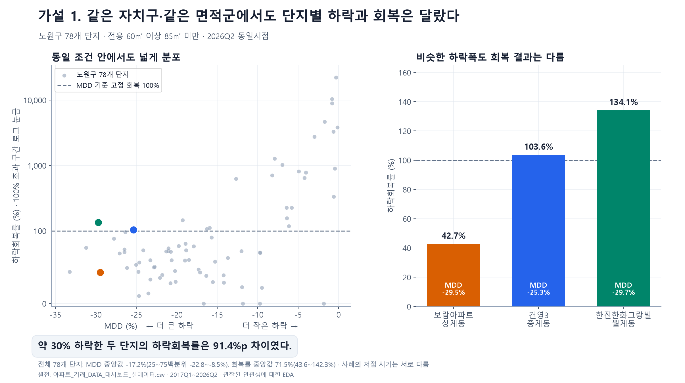
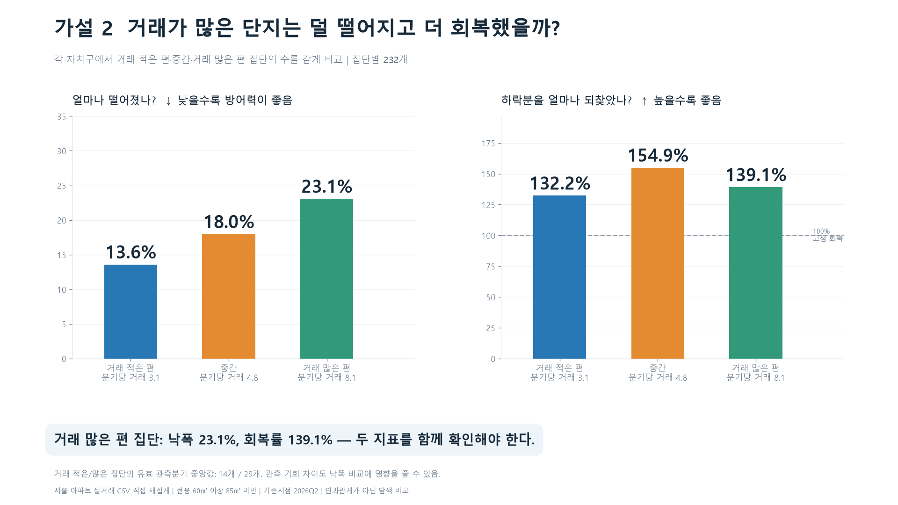
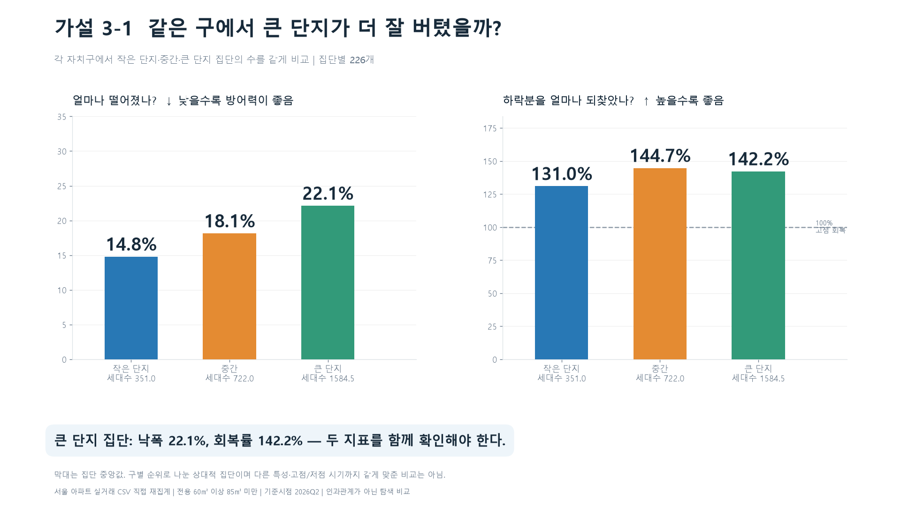
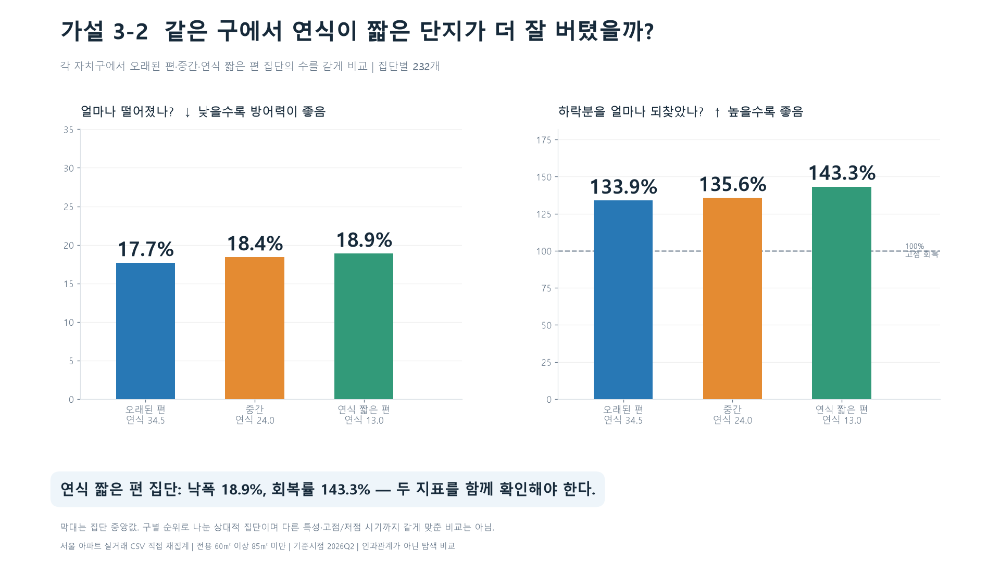
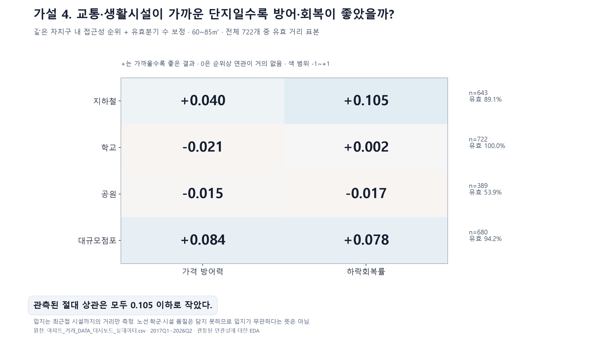

# 실제 발표 이미지별 예상 질문과 상세 답변

대상은 [`최종_발표이미지`](최종_발표이미지/) 폴더에서 직접 확인한 **5장**이다. 가설 1, 가설 2, 가설 3-1, 가설 3-2, 가설 4를 다룬다. 이 폴더에는 가설 5 이미지가 없으므로 다른 버전의 가설 5를 섞지 않았다. 이미지는 변경하지 않았다.

## 0. 발표 전에 가장 먼저 구분할 것

**현재 그림은 엄밀한 통계적 가설검정 결과가 아니라 가설에 관한 탐색적 데이터 분석(EDA)이다.**

집단 중앙값·분포·보정상관을 계산했지만, 귀무가설에 대한 p값·유의수준·신뢰구간을 산출하지 않았다. 따라서 “통계적으로 유의하다”, “가설을 기각했다”, “원인을 증명했다”라고 답하면 안 된다. **“이 표본에서 이런 패턴이 관측됐다”**라고 답하는 것이 정확하다.

참고 폴더에는 서로 다른 계산 방식의 그림이 함께 있다.

| 그림 | 실제 분석 방식 | 표본 수의 의미 | 숫자 단위 |
| --- | --- | --- | --- |
| 가설 1 | 노원구 단지별 산점도 + 3개 사례 | 조건을 충족한 노원구 78개 단지 | MDD %, 하락회복률 %, 차이는 %p |
| 가설 2 | 각 구에서 거래 활발도 3집단을 같은 수로 선정한 뒤 집단 중앙값 비교 | 집단별 232개, 합계 696개 | 낙폭 %, 회복률 %, 거래 건/관측분기 |
| 가설 3-1 | 각 구에서 세대수 3집단을 같은 수로 선정한 뒤 집단 중앙값 비교 | 집단별 226개, 합계 678개 | 낙폭 %, 회복률 %, 세대 |
| 가설 3-2 | 각 구에서 연식 3집단을 같은 수로 선정한 뒤 집단 중앙값 비교 | 집단별 232개, 합계 696개 | 낙폭 %, 회복률 %, 년 |
| 가설 4 | 각 구 내 순위를 사용하고 유효분기 수를 보정한 상관 | 시설별 유효 단지 수 643·722·389·680 | 무단위 상관계수; 유효비율은 % |

**가설 2·3을 상관계수 그래프로 설명하거나 가설 4를 가까운/먼 집단의 중앙값 비교로 설명하면 안 된다.** 또한 가설 3-1은 ‘300세대 미만/1,000세대 이상’의 고정 기준 그림이 아니다.

---

## 1. 공통 기본 질문: 표본·기간·가격·지표

### Q1. 어떤 데이터를 사용했나요?

**짧은 답변:** “서울 아파트 실거래 정보에 단지 기본정보와 시설 거리 정보를 결합한 프로젝트의 실데이터 CSV를 사용했습니다.”

지정 파일은 `거래_단지_DATA/아파트_거래_DATA_대시보드_실데이터.csv`다. 원천에는 **610,341행의 거래 기록**, **25개 자치구**, 전처리 규칙상 **8,963개 단지**가 있다. 숫자 610,341은 이 그림의 표본 수가 아니다. 전체 기간·여러 면적군을 포함하는 원천 거래 행 수다.

### Q2. 분석에서 ‘표본’이란 무엇인가요?

분석 기준을 만족해 실제 비교에 사용한 대상을 뜻한다. 이 프로젝트에서는 거래 기록으로 단지별 지표를 계산한 후, **‘단지 × 면적군’**을 비교한다. 그림에서는 면적군을 하나로 고정했으므로 점·표본 1개를 ‘해당 면적군의 단지 1개’라고 설명할 수 있다.

한 단지가 전용 59㎡와 84㎡ 거래를 모두 갖고 있어도 이 그림에서는 60~85㎡ 미만의 거래만 지표 산출에 사용한다.

### Q3. n은 무엇인가요? 세대 수나 거래 건수인가요?

**n은 해당 계산에 들어간 단지 수다.** 거래 건수·아파트 세대 수·시설 수가 아니다. n=232는 232건의 매매가 아니라 232개 단지의 지표를 비교했다는 뜻이다.

각 단지 지표는 여러 거래로 계산된다. 그림의 왼쪽 낙폭과 오른쪽 회복률은 같은 단지를 다시 보여주므로 표본 수를 두 배로 세지 않는다.

### Q4. 원천 기간과 실제 분석 기간은 어떻게 다른가요?

| 구분 | 범위 |
| --- | --- |
| 원천 CSV에 존재하는 계약일 | 2017-01-01~2026-08-31 |
| 그림의 가격 이력 사용 범위 | 2017Q1~2026Q2 |
| 날짜로 표현한 분석 범위 | 2017-01-01~2026-06-30 |
| 현재 가격의 기준 시점 | 2026년 2분기 |
| 전체 달력상 분기 수 | 38개 분기 |

**“2026Q2 동일시점”은 현재 가격의 비교 시점이 같다는 뜻이지, 모든 단지의 관측기간·고점·저점이 같다는 뜻은 아니다.**

### Q5. Q1·Q2·Q3·Q4는 무엇인가요?

1년을 3개월씩 나눈 분기다. Q1은 1~3월, Q2는 4~6월, Q3는 7~9월, Q4는 10~12월이다. 2026Q2 가격은 6월 말 하루의 가격이나 마지막 거래 1건이 아니라, 조건을 만족하는 **4~6월 거래로 계산한 분기 대표가격**이다.

### Q6. 왜 2026Q3가 아니라 Q2인가요?

원천 자료의 마지막 거래일이 8월 31일이라 Q3에는 9월 거래가 없다. 완결 분기와 미완결 분기를 섞지 않기 위해 Q2를 사용했다. 다만 분기가 끝났다는 사실이 신고 지연·해제·정정까지 모두 확정됐음을 뜻하지는 않는다.

### Q7. 모든 단지가 2017년부터 38개 분기 동안 관측됐나요?

아니다. 신축 단지는 이력이 짧고, 기존 단지도 거래가 없거나 너무 적은 분기가 있다. 38개는 전체 달력 범위다. 실제 단지별 가격 지표에는 그 단지의 **거래 3건 이상인 유효 분기**만 사용한다.

### Q8. 표본 선정 조건을 순서대로 설명해 주세요.

1. 서울 아파트 거래에서 전용면적 **60㎡ 이상 85㎡ 미만**을 선택한다.
2. 단지·면적군·분기별 대표가격을 계산한다.
3. 거래가 **3건 이상**인 완결 분기를 지표에 사용한다.
4. 그러한 분기가 **4개 이상** 있어야 한다. 연속 4개일 필요는 없다.
5. 현재 시점인 **2026Q2에도 거래가 3건 이상** 있어야 한다.
6. MDD 계산상 하락이 관측되고 하락회복률이 정의되는 **894개**를 얻는다.
7. 가설 1은 이 중 노원구 **78개**를 사용한다.
8. 가설 2~4는 낙폭 **5% 이상 722개**를 출발 표본으로 사용하고, 집단 균형·특성 결측·시설 유효값 조건에 따라 추가로 일부를 제외한다.

### Q9. 894개와 722개는 왜 다른가요?

하락회복률의 분모는 고점과 저점의 차이다. 낙폭이 매우 작으면 회복률이 과도하게 커질 수 있어, 특성 비교에서는 낙폭 5% 미만인 **172개**를 제외했다. 가설 1은 그런 극단값까지 포함한 전체 분포를 보여준다.

5%는 탐색적 필터이지 안전한 단지를 나누는 공식 기준이 아니다. 방어를 잘한 작은 낙폭 단지가 제외되므로 가설 2~4의 결과를 모든 서울 아파트에 일반화할 수 없다. 필터로 제외된 단지가 ‘나쁜 데이터’라는 뜻도 아니다.

### Q10. 3건·4개 분기 기준은 통계적으로 검증된 기준인가요?

소수 거래로 지표가 지나치게 흔들리는 상황을 줄이고 최소 가격 이력을 확보하기 위한 프로젝트의 운영 기준이다. 이 기준을 통과했다고 충분한 통계적 신뢰성이 보장되는 것은 아니다. 기준을 높이거나 낮췄을 때 표본과 결과가 얼마나 달라지는지 별도 민감도 분석이 필요하다.

### Q11. 가격은 총 매매가인가요, 평당가인가요?

지표 산출의 기초는 **만원/㎡** 단가다.

`개별 거래 단가 = 거래금액(만원) ÷ 전용면적(㎡)`

예를 들어 84㎡ 아파트가 84,000만원에 거래됐다면 1,000만원/㎡다. 같은 단지·같은 면적군·같은 분기의 개별 단가들을 모아 **중앙값**을 구한다. 총가격 평균이나 평당가가 아니다. 최종 그림의 MDD·회복률에는 가격 단위 대신 %를 표시한다.

### Q12. 평균 대신 중앙값을 사용한 이유는 무엇인가요?

일부 매우 높거나 낮은 거래가 대표값에 미치는 영향을 줄이기 위해서다. 예를 들어 900, 1,000, 2,000만원/㎡의 중앙값은 1,000이고 평균은 1,300이다. 중앙값도 거래가 매우 적으면 불안정하며 층·정확한 면적의 거래 구성 변화까지 해결하지는 않는다.

### Q13. 그래프의 중앙값은 어떤 순서로 계산되나요?

**거래 단가 → 단지별 분기 중앙가격 → 단지별 MDD·회복률 → 비교 집단의 지표 중앙값** 순서다.

특성의 중앙값, 낙폭의 중앙값, 회복률의 중앙값은 각 열에서 따로 계산한다. 따라서 ‘거래 3.1건, 낙폭 13.6%, 회복률 132.2%’를 모두 갖는 실제 대표 단지가 반드시 존재하는 것은 아니다.

### Q14. 거래가 많은 단지가 집단 중앙값에서도 더 큰 가중치를 갖나요?

집단 지표를 요약할 때는 단지마다 지표 1개씩을 사용한다. 거래 100건 단지의 MDD를 거래 10건 단지보다 10배 가중하지 않는다. 다만 거래량은 해당 단지의 분기 대표가격과 유효분기 수에 영향을 준다.

또한 가설 2·3에서 집단 간 자치구 구성은 같지만, **25개 구 자체를 각각 1/25로 가중한 것은 아니다.** 분석 단지가 많은 구는 각 집단에도 더 많이 포함된다.

### Q15. MDD는 정확히 무엇인가요?

관측된 가격 이력에서 **그때까지의 고점 대비 가장 크게 하락한 비율**이다. 각 유효 분기에서 `현재 분기 가격 / 그 이전을 포함한 누적 최고가격 - 1`을 구하고, 가장 낮은 값을 선택한다.

반드시 고점이 먼저, 저점이 나중이어야 한다. 전체 기간 최고가와 최저가를 시간 순서와 무관하게 뺀 값은 아니다. 분기 중앙가격을 사용하므로 개별 거래 최고·최저가의 낙폭과도 다르다.

### Q16. 그림마다 MDD 부호가 다른 이유는 무엇인가요?

- 가설 1 X축: **음수 MDD**. -10%가 -30%보다 적게 하락했으므로 오른쪽일수록 방어력이 좋다.
- 가설 2·3 왼쪽 막대: **낙폭의 절댓값**. 10%가 30%보다 적게 하락했으므로 낮을수록 좋다.
- 가설 4 ‘가격 방어력’: 음수 MDD가 덜 음수일수록 좋은 방향으로 순위화했다. 상관의 +가 가설 방향이 되도록 구성했다.

### Q17. 회복률 100%·150%는 무슨 뜻인가요?

`하락회복률 = (현재 가격 C - 저점 L) / (MDD 구간 고점 H - 저점 L) × 100`

고점 100, 저점 80인 예시에서 현재 90이면 50%, 100이면 100%, 110이면 150%다. 이때 가격은 고점 대비 10% 상승했지만 하락회복률은 150%다. **회복률은 현재 가격 상승률과 다르다.**

### Q18. 회복률이 높으면 더 빨리 회복했다는 뜻인가요?

아니다. 회복률은 기준 시점에 얼마나 회복한 상태인지 보여준다. 회복 속도를 보려면 저점 이후 기준 고점에 처음 도달할 때까지의 기간을 별도로 계산해야 한다. 저점 시점도 단지마다 달라 회복할 시간이 같지 않다.

### Q19. 여기서 ‘고점’은 항상 사상 최고가인가요?

아니다. **선택된 최대 하락 구간의 기준 고점**이다. 그 뒤 새 최고가가 발생해도 이 회복률의 분모가 되는 과거 고점을 바꾸지 않는다. 따라서 회복률 100%를 넘었다고 오늘까지의 사상 최고가를 모두 회복했다는 뜻은 아니다.

### Q20. %와 %p는 어떻게 구분하나요?

각 비율은 %이고 비율끼리 뺀 차이는 %p(퍼센트포인트)다. 134.1%-42.7%=91.4%p다. 이를 91.4% 더 회복했다고 표현하면 상대적 증가율과 혼동될 수 있다.

### Q21. 거래가 없는 분기는 어떻게 처리했나요?

가격을 보간하거나 직전 가격으로 채우지 않았다. 거래 1~2건인 분기도 MDD·회복률 산출에서 제외했다. 따라서 거래 공백 사이의 실제 고점·저점을 놓쳤을 수 있다.

**관측분기 수**는 거래가 1건 이상 있는 분기 수이고, **유효분기 수**는 그중 거래 3건 이상인 분기 수다. 두 숫자는 다르다.

### Q22. 같은 자치구·면적군이면 완전히 같은 조건인가요?

아니다. 법정동·역 접근성·층·향·동·정확한 전용면적·연식·브랜드·거래 유형·관측기간은 다를 수 있다. 정확한 표현은 **“자치구와 면적군이라는 두 비교 기준을 맞췄다”**다. 60㎡와 84.9㎡도 이 면적군에 함께 들어간다. 정확히 85㎡는 제외된다.

### Q23. 한 단지는 어떻게 구분했나요?

기존 전처리 규칙상 매칭완료이고 KAPT 코드가 있으면 그 코드를 사용한다. 그렇지 않은 경우 시군구·주소(또는 번지)·단지명을 조합한 식별자를 사용한다. 거래마다 같은 단지 기본정보가 다르게 붙은 경우에는 가장 자주 나타난 정보 묶음을 사용하며 동률은 원천 행 순서로 정한다.

이 규칙이 모든 단지를 완벽하게 식별한다는 뜻은 아니다. 단지 매칭 오류·명칭 차이·정보 갱신 시점의 차이는 남을 수 있다.

### Q24. 이상치·해제 거래·중복은 모두 해결됐나요?

해제 표시, 잘못된 날짜, 0 이하 또는 유효하지 않은 가격·면적, 단지명·지역 누락을 검사하는 전처리 규칙을 적용했다. 이 원천에서 해당 검사로 제외된 행은 0건이었다. 그러나 이는 모든 오류가 없다는 인증이 아니다.

시장 맥락상 급매·특수관계인 거래·모든 중복 거래를 완벽히 판별했다고 말할 근거는 없다. 중앙값과 낙폭 필터 역시 모든 이상치를 제거하는 절차가 아니다. 단가를 물가로 조정하거나 금리·대출규제를 통계적으로 통제한 분석도 아니다.

---

## 2. 가설 1: 같은 자치구·면적군의 분포와 세 단지 사례

### 읽을 숫자

| 항목 | 값 |
| --- | --- |
| 분석조건을 충족한 노원구 단지 | 78개 |
| MDD 중앙값 | -17.2% |
| MDD 25~75백분위 | -22.8%~-8.5% |
| 회복률 중앙값 | 71.5% |
| 회복률 25~75백분위 | 43.6%~142.3% |

| 사례 | 법정동 | MDD | 회복률 | 기준 고점 | 저점 |
| --- | --- | --- | --- | --- | --- |
| 보람아파트 | 상계동 | -29.5% | 42.7% | 2021Q3 | 2024Q1 |
| 건영3 | 중계동 | -25.3% | 103.6% | 2021Q2 | 2023Q1 |
| 한진한화그랑빌 | 월계동 | -29.7% | 134.1% | 2021Q3 | 2023Q1 |

### Q25. 점 하나는 무엇이고 78개는 무엇인가요?

점 하나는 노원구 단지 1개의 60~85㎡ 미만 면적군에 대한 MDD·회복률 조합이다. **노원구에 존재하는 전체 단지가 78개라는 뜻이 아니라, 분석조건을 충족한 하락 관측 단지가 78개라는 뜻**이다. 이번 그림에서는 낙폭 5% 필터를 적용하지 않았다.

### Q26. 색깔 있는 점이 있으니 총 81개 아닌가요?

아니다. 주황·파랑·초록 3개는 회색 분포에 이미 들어 있는 단지를 강조한 것이다. 서로 겹친 점도 있을 수 있어 눈으로 세는 점 수가 78보다 적어 보일 수 있다.

### Q27. 오른쪽 막대와 왼쪽 점은 같은 단지인가요?

같다. 주황은 보람아파트, 파랑은 건영3, 초록은 한진한화그랑빌이다. 오른쪽 막대 높이는 회복률이고 막대 내부의 MDD 글자는 별도 지표다. 오른쪽 막대 높이를 MDD로 읽으면 안 된다.

### Q28. 산점도에서 어느 쪽이 좋은가요?

오른쪽은 덜 하락했고 위쪽은 하락회복률이 높은 상태다. 다만 오른쪽 위를 ‘무조건 우량 단지’로 읽으면 안 된다. 작은 낙폭은 회복률을 크게 만드는 분모 효과가 있고 관측 시점·표본 안정성도 다르다.

### Q29. Y축 100·1,000·10,000 간격이 비슷한 이유는 무엇인가요?

큰 회복률까지 한 화면에 표시하기 위해 **100% 이하에서는 선형, 100%를 넘으면 로그 눈금**을 사용했다. 100→1,000과 1,000→10,000은 모두 10배 차이여서 비슷한 간격을 차지한다. 위쪽에서 같은 세로 길이가 같은 %p 차이라는 뜻은 아니다. 오른쪽 사례 막대는 일반 선형 눈금이다.

### Q30. 회복률이 10,000%를 넘는 점은 계산 오류인가요?

그 숫자만으로 오류라고 할 수 없다. 고점과 저점 차이가 매우 작으면 분모가 작아져 발생한다. 이 노원구 표본의 최대 회복률은 약 **22,123.3%**, 그 단지의 낙폭은 약 **0.338%**다. 가격이 221배가 됐다는 뜻은 아니다.

예를 들어 고점 100, 저점 99, 현재 110이면 회복률은 1,100%지만 고점 대비 상승률은 10%다. 이런 해석 문제 때문에 이후 특성 비교에서는 낙폭 5% 이상으로 범위를 좁혔다.

### Q31. 회복률 0% 점은 거래가 없다는 뜻인가요?

아니다. 공식상 현재 가격이 해당 저점과 같은 상태라는 뜻이다. 노원구 표본에서는 회복률이 0%인 단지가 **4개**다. Q2 유효 거래 기준을 통과했으므로 단순히 거래가 없어서 0으로 채운 값이 아니다.

### Q32. 왜 노원구와 이 세 단지를 골랐나요?

같은 구·면적군 내부의 분포와, 비슷한 낙폭 이후 다른 회복 상태가 공존한다는 점을 이해하기 쉽게 보여주는 사례다. 세 단지는 무작위 대표 표본이 아니라 **설명을 위해 선택한 사례**다. 실제 동도 상계동·중계동·월계동으로 다르다.

무작위 선정이나 객관적인 최적 사례 선정을 했다고 주장하지 않는다. “3개 사례만으로 결론 낸 것 아닌가요?”에는 “왼쪽은 조건을 충족한 78개 전체 분포이고 오른쪽은 그중 설명용 사례입니다”라고 답한다.

### Q33. 91.4%p 차이는 누구 사이의 차이인가요?

보람아파트와 한진한화그랑빌의 차이다. 반올림 전 계산은 134.10596%-42.70843%=91.39753%p이고 한 자리로 반올림하면 91.4%p다. 세 단지 평균 격차나 전체 78개의 평균 격차가 아니다.

### Q34. 한진한화그랑빌이 보람보다 회복 능력이 좋다고 말할 수 있나요?

**2026Q2 기준 관측 회복률은 높다**고 말할 수 있다. 고유 능력이나 원인이 입증된 것은 아니다. 두 단지는 고점은 2021Q3로 같지만 저점이 2023Q1과 2024Q1로 다르다. 저점 이후 Q2까지의 경과기간은 각각 13분기와 9분기로 4분기 차이가 난다. 이는 경과한 달력 분기 수이며 매 분기 거래가 충분했다는 뜻은 아니다.

### Q35. 25~75백분위는 신뢰구간인가요?

아니다. 관측 단지들의 지표 분포에서 가운데 50%가 위치한 구간이다. MDD -22.8%~-8.5%, 회복률 43.6%~142.3%는 **분포의 사분위 구간**이지 모평균의 95% 신뢰구간이 아니다.

### Q36. 이 장에서 안전하게 말할 수 있는 결론은 무엇인가요?

> “분석조건을 충족한 노원구 78개 단지에서도 하락과 회복 수준의 분포가 넓었습니다. 비슷하게 하락한 두 사례도 현재 회복률은 달랐습니다. 다만 세부 입지와 저점 시점까지 같지는 않습니다.”

---

## 3. 가설 2: 거래 활발도와 낙폭·회복률

| 집단 | n | 거래/관측분기 중앙값 | 낙폭 중앙값 | 회복률 중앙값 | 유효분기 수 중앙값 |
| --- | --- | --- | --- | --- | --- |
| 거래 적은 편 | 232 | 3.1건 | 13.6% | 132.2% | 14개 |
| 중간 | 232 | 4.8건 | 18.0% | 154.9% | 21개 |
| 거래 많은 편 | 232 | 8.1건 | 23.1% | 139.1% | 29개 |

### Q37. 232개는 전체 표본인가요?

집단 하나의 표본이다. 세 집단 합계는 **696개**이고 25개 구를 모두 포함한다. 출발 표본 722개에서 집단 수를 같게 맞추는 과정에서 **26개**를 제외했다. 가격 결과가 이상해서 제외한 것이 아니다.

### Q38. 거래 활발도는 Q2 거래량인가요?

아니다. 이 그림에서는 `2017Q1~2026Q2의 해당 단지·면적군 총거래수 / 거래가 1건 이상 있는 관측분기 수`를 사용했다. Q2만의 거래량이나 세대수 대비 거래 회전율과 다르다.

각 단지의 평균을 계산한 뒤 그 평균들의 집단 중앙값을 표시했으므로 3.1처럼 소수가 나온다. 한 분기에 거래가 0.1건 발생했다는 뜻이 아니다.

### Q39. 거래 없는 분기도 분모에 들어가나요?

아니다. 예를 들어 달력상 12분기 중 8분기에 거래가 총 40건 발생했다면 40/8=5건이다. 40/12가 아니다. 따라서 “달력상 매 분기 평균 5건”이라고 표현하면 부정확하다. 발표에서는 **“거래가 관측된 분기당 거래수”**라고 설명한다.

### Q40. MDD에서 제외된 1~2건 거래 분기도 거래 활발도에는 포함되나요?

그렇다. 거래 활발도의 분자는 전체 거래수이고 분모는 1건 이상 있는 분기 수다. MDD·회복률은 3건 이상 분기의 대표가격만 사용한다. 거래 빈도를 요약하는 기준과 가격 지표의 최소표본 기준은 구분되어 있다.

### Q41. ‘적은 편·중간·많은 편’은 어떻게 나눴나요?

각 자치구 안에서 거래 활발도 순으로 정렬하고, 구별 유효 단지 수를 3으로 나눈 몫만큼 각 집단에 배정했다. 하위·중앙·상위 구간에서 같은 수를 뽑는다. 예를 들어 8개라면 순서 1·2 / 4·5 / 7·8을 선택하고 3·6은 제외한다.

무작위 추출이 아니고, 3.1건·4.8건·8.1건을 경계값으로 사용한 것도 아니다. 이 숫자는 **선정 후의 집단 중앙값**이다. 동률은 단지 식별자 순서로 처리한다.

### Q42. 3.1건 이하면 적은 편, 8.1건 이상이면 많은 편인가요?

아니다. 구별 상대적 분류다. 실제로 적은 편 집단의 거래 활발도 범위는 약 1.78~5.83건/관측분기, 많은 편은 약 5.18~37.74건/관측분기로 일부 겹친다. 어떤 구에서 많은 편인 단지가 다른 구에서는 적은 편일 수 있기 때문이다.

### Q43. 자치구 조건을 맞췄다는 것은 어떤 의미인가요?

예를 들어 A구에서 각 집단에 10개, B구에서 각 집단에 7개씩 넣는 방식이다. 집단 간 자치구별 구성비가 같아진다. 그러나 구 내부의 세대수·연식·입지·관측기간은 통제하지 않았고 모든 구를 똑같은 가중치로 평균한 것도 아니다.

### Q44. 거래 많은 집단이 왜 더 크게 떨어졌나요?

이 그림만으로 원인을 확정할 수 없다. 중요한 단서는 유효분기 수 중앙값이 **14개→21개→29개**라는 점이다. 관측 가능한 시점이 많으면 하락을 포착할 기회도 달라진다. 거래 활발도가 규모·가격대 등과 같이 움직일 수도 있다.

“거래가 많아서 가격이 떨어졌다” 또는 “거래가 적을수록 안전하다”라는 인과 결론은 낼 수 없다. 14개 유효분기는 연속 3.5년 관측과 같은 뜻도 아니다.

### Q45. 회복률은 거래 많은 집단이 조금 높으니 가설이 맞는 것 아닌가요?

적은 편과 많은 편만 비교하면 회복률 중앙값은 132.2%→139.1%로 약 **6.9%p** 높다. 하지만 낙폭은 13.6%→23.1%로 약 **9.5%p 더 크고**, 회복률이 가장 높은 집단은 중간의 154.9%다.

따라서 “거래가 많을수록 덜 하락하고 더 회복한다”는 두 지표의 일관된 우위는 관측되지 않았다. 회복률의 일부 차이가 유의한지는 별도 검정하지 않았다.

### Q46. 거래량이 수요를 의미하나요?

거래량은 매수·매도가 실제 체결된 결과다. 매수 대기수요나 거래되지 않은 매물, 급매 출회 압력까지 직접 측정하지는 않는다. 단지 세대수가 많으면 거래수가 많을 가능성도 있어 순수한 수요지표로 동일시하지 않는다.

### Q47. 이 그림은 관측기간 보정 결과인가요?

아니다. 구별 집단 수를 맞춘 **원지표 중앙값 비교**다. 아래에 유효분기 수를 알려주지만 그 영향을 통계적으로 제거한 그림은 아니다. 가설 4와 혼동하지 않는다.

**발표 답변:** “거래 활발도별 비교에서 낙폭과 회복률이 같은 방향으로 좋아지지는 않았습니다. 특히 유효 관측분기가 달라 거래량 하나로 방어력을 판단하기 어렵습니다.”

---

## 4. 가설 3-1: 세대수와 낙폭·회복률

| 집단 | n | 세대수 중앙값 | 낙폭 중앙값 | 회복률 중앙값 | 유효분기 수 중앙값 |
| --- | --- | --- | --- | --- | --- |
| 작은 단지 | 226 | 351.0세대 | 14.8% | 131.0% | 16개 |
| 중간 | 226 | 722.0세대 | 18.1% | 144.7% | 22개 |
| 큰 단지 | 226 | 1,584.5세대 | 22.1% | 142.2% | 27개 |

### Q48. 왜 여기서는 n=226인가요?

출발 722개 중 세대수 결측 13개를 제외하면 709개다. 각 구에서 세 집단의 수를 맞추면서 31개를 추가 제외해 **678개=226×3**가 된다. 세대수를 0으로 채우거나 작은 단지로 분류하지 않았다.

### Q49. 작은 단지는 300세대 미만, 큰 단지는 1,000세대 이상인가요?

이 그림은 그렇지 않다. **각 구 안에서 상대적으로 세대수가 적은 집단·중간·많은 집단**이다. 351·722·1,584.5는 집단 중앙값이지 경계값이 아니다. 이전 고정 구간 분석의 n=94·386·229와 혼용하면 안 된다.

### Q50. 1,584.5세대인 아파트가 실제로 있나요?

개별 단지 세대수가 소수라는 뜻이 아니다. 집단이 226개로 짝수여서 정렬한 가운데 두 값의 평균이 중앙값이 될 수 있다. 그 결과 .5가 나올 수 있다. 단지별 값의 원단위는 세대다.

### Q51. 작은 집단인데 700세대 넘는 단지가 들어갈 수 있나요?

가능하다. 실제 이 분석에서 작은 집단은 **138~784세대**, 큰 집단은 **712~9,510세대** 범위다. 전체 서울에 하나의 절대 기준을 적용한 것이 아니라 각 구에서 순위를 나눴기 때문에 범위가 겹친다.

### Q52. 세대수는 60~85㎡ 세대수인가요?

아니다. 단지 기본정보에 있는 **단지 전체 세대수**다. 가격 지표와 거래 활발도는 해당 면적군으로 계산했지만 세대수는 그 면적군의 세대수만 분리한 값이 아니다. 따라서 전체 세대수로 나눈 거래 회전율을 정확한 면적군 유동성으로 해석하는 데도 제약이 있다.

### Q53. 세대수는 거래 당시의 과거 값인가요?

현재 CSV에 결합된 단지 기본정보를 사용했다. 분기마다 당시의 세대수·커뮤니티·주차 상태를 역사적으로 복원한 패널 데이터는 아니다. 기준시점의 불일치 가능성을 인정해야 한다.

### Q54. 큰 단지의 회복률이 높으면 가설을 지지하나요?

작은 집단 대비 큰 집단의 회복률 중앙값은 약 **11.2%p** 높다. 하지만 낙폭도 약 **7.3%p 더 크며**, 회복률 최댓집단은 중간(144.7%)이다. “규모가 커질수록 두 지표 모두 우수하다”는 주장은 이 그림으로 뒷받침되지 않는다.

### Q55. 큰 단지는 왜 더 크게 떨어졌나요? 관리가 나쁜가요?

관리 수준은 측정하지 않았다. 큰 집단은 유효분기 수 중앙값도 27개로 작은 집단의 16개보다 많다. 시장 노출·관측 기회·연식·입지 차이가 섞여 있으므로 ‘규모 때문에 하락했다’거나 ‘관리가 나쁘다’고 설명할 수 없다.

**발표 답변:** “같은 구 안에서 상대적 규모를 나눴더니 큰 단지 집단의 낙폭도 컸고 회복률도 작은 집단보다 높았습니다. 규모 하나로 하락 방어와 회복을 함께 판단하기는 어려웠습니다.”

---

## 5. 가설 3-2: 연식과 낙폭·회복률

| 집단 | n | 연식 중앙값 | 낙폭 중앙값 | 회복률 중앙값 | 유효분기 수 중앙값 |
| --- | --- | --- | --- | --- | --- |
| 오래된 편 | 232 | 34.5년 | 17.7% | 133.9% | 21개 |
| 중간 | 232 | 24.0년 | 18.4% | 135.6% | 22개 |
| 연식 짧은 편 | 232 | 13.0년 | 18.9% | 143.3% | 20개 |

### Q56. 연식은 어떻게 계산했나요?

**2026-건축연도**다. 월·일까지 고려한 정확한 경과 연수가 아니며 매 거래 당시의 연식도 아니다. 예를 들어 2013년 건축이면 13년이다. 34.5는 짝수 집단의 중앙값 계산에서 나올 수 있다.

### Q57. 신축 기준이 10년 이하인가요?

아니다. 현재 참고 이미지에서는 **각 구에서 상대적으로 연식이 짧은 쪽**을 선정했다. 고정된 10년 이하 기준을 쓰지 않는다. 그래서 짧은 집단의 연식 중앙값이 13년이어도 모순이 아니다. ‘신축’보다는 이미지처럼 ‘연식 짧은 편’이라고 표현하는 것이 정확하다.

### Q58. 연식 구간이 서로 겹칠 수 있나요?

가능하다. 실제 오래된 집단 범위는 18~55년, 중간은 13~37년, 짧은 집단은 3~29년이다. 구별 상대적 순위이므로 어떤 구에서 짧은 편인 단지가 다른 구의 오래된 집단보다 연식이 길 수 있다. 이 범위는 모집단의 신축·구축 공식 분류가 아니다.

### Q59. 왜 거래 활발도와 동일하게 n=232인가요?

722개 출발 표본에서 연식이 모두 확인됐고, 구별 표본 수가 같은 상태에서 세 집단의 수를 맞췄기 때문이다. 합계 696개이며 26개를 균형화 과정에서 제외했다. 다만 **선정한 단지의 명단까지 가설 2와 같다는 뜻은 아니다.** 거래량과 연식이라는 서로 다른 특성으로 정렬했다.

### Q60. 회복률은 신축 쪽일수록 높아지는데 왜 가설이 아니라고 하나요?

이 지적은 타당하다. **이 그림에서는 회복률 중앙값이 133.9%→135.6%→143.3%로 연식이 짧은 집단일수록 높아진다.** 이 관측 방향을 인정해야 한다.

다만 낙폭도 17.7%→18.4%→18.9%로 커져 ‘덜 하락한다’는 방어 측면의 예상과는 다르다. 올바른 결론은 **“짧은 연식 집단의 회복률은 높았지만 방어력까지 좋지는 않았다”**다. 다른 버전에서 사용했던 “회복률 순서가 일관되지 않았다”라는 설명을 이 이미지에 적용하면 안 된다.

### Q61. 연식에 따른 차이가 큰가요?

오래된 집단 대비 짧은 집단의 낙폭 중앙값은 약 **1.2%p 더 크고**, 회복률은 약 **9.4%p 높다**. 이 차이가 실질적으로 중요한지, 표본 오차를 넘는지에 대한 기준이나 유의성 검정은 적용하지 않았다.

막대가 큰 차이처럼 보인다는 인상만으로 ‘신축 효과가 크다’고 말하지 않는다. 그래프 축은 0부터 시작하지만 집단 내부 분산도 이 막대만으로는 알 수 없다.

### Q62. 오래된 단지의 재건축 기대는 반영했나요?

재건축 추진 단계·사업성·정비구역 지정 여부 등을 별도 변수로 반영하지 않았다. 따라서 연식이라는 하나의 변수에 일반적인 노후도와 다른 시장 기대가 섞일 수 있다. 실제 재건축 효과를 이 그림에서 확인했다고 말할 수는 없다.

### Q63. 연식이 짧으면 관측기간도 짧지 않나요?

그럴 수 있다. 이 그림의 유효분기 수 중앙값은 오래된/중간/짧은 집단에서 21/22/20개지만 중앙값이 비슷하다고 각 단지의 관측 시작·고점·저점 시점까지 동일한 것은 아니다. 같은 시장 하락 국면을 경험했는지 추가 비교가 필요하다.

**발표 답변:** “연식이 짧은 집단은 회복률 중앙값이 높았지만 낙폭이 더 작지는 않았습니다. 신축 여부만으로 두 지표를 모두 대신 판단하기는 어렵습니다.”

---

## 6. 가설 4: 시설 접근성과 가격 지표의 보정 순위상관

| 시설 | 유효 n | 722개 중 유효비율 | 제외된 단지 | 방어력 상관 | 회복률 상관 |
| --- | --- | --- | --- | --- | --- |
| 지하철 | 643 | 89.1% | 79 | +0.040 | +0.105 |
| 학교 | 722 | 100.0% | 0 | -0.021 | +0.002 |
| 공원 | 389 | 53.9% | 333 | -0.015 | -0.017 |
| 대규모점포 | 680 | 94.2% | 42 | +0.084 | +0.078 |

### Q64. n=643은 지하철역 643개를 분석했다는 뜻인가요?

아니다. 출발 표본 722개 중 **지하철 거리 정보가 유효한 아파트 단지 643개**를 사용했다는 뜻이다. 여러 아파트가 같은 역에 연결될 수 있다. 학교 n=722도 학교 722개를 뜻하지 않는다.

### Q65. 89.1%는 무엇인가요?

643/722×100이다. 분석 후보 단지 중 지하철 거리값이 계산 기준상 유효한 비율이다. 역세권 단지 비율, 역 이용률, 분석 정확도 또는 회복 확률이 아니다.

### Q66. 시설별 n을 합하면 전체 단지 수가 되나요?

아니다. 같은 단지가 여러 시설 분석에 반복 참여한다. 같은 시설의 방어력 열과 회복률 열도 같은 n을 사용한다. 모든 시설의 공통 완전 표본만 사용한 분석이 아니라 **시설별로 유효 단지를 각각 선택**했다.

### Q67. 유효한 거리 정보는 어떤 값인가요?

현재 전처리에서는 단지 좌표가 유효하고 시설명이 있으며 **거리값이 0~1,000m**일 때 시설 상태를 `ok`로 분류한다. 이 규칙은 공원에만 적용되는 것이 아니라 네 시설 모두에 적용된다. 시설 좌표 자체의 완전성을 추가 확인하는 별도 플래그와 동일한 조건은 아니다.

따라서 1km 초과 값·시설명 누락·단지 좌표 누락 등은 이 분석에서 사용하지 않는다. **전체 거리 범위를 분석한 것이 아니다.**

### Q68. 공원의 유효비율이 53.9%인 이유는 무엇인가요?

위 유효조건을 만족한 값이 722개 중 389개이기 때문이다. 이를 나머지 333개 주변에는 공원이 없다고 단정할 수 없다. 매핑 범위 밖이거나 데이터가 누락됐을 수도 있다. 결측·범위 제한이 무작위가 아니면 결과에도 편향이 생길 수 있다.

### Q69. 학교는 초등학교만을 의미하나요?

아니다. 현재 이 이미지가 사용하는 `학교` 시설 매핑에는 초·중·고가 함께 들어간다. 표본 722개의 매핑된 학교 유형을 확인하면 **초등학교 446개 단지, 중학교 180개 단지, 고등학교 96개 단지**다. 이 숫자도 서로 다른 학교 수가 아니라 각 유형에 매핑된 단지 수다.

따라서 ‘초품아 효과’나 특정 학군 효과를 직접 검증했다고 설명할 수 없다.

### Q70. 거리는 도보시간인가요?

그림은 CSV에 저장된 최근접 시설 거리(m)를 사용한다. 도보 소요시간이나 실제 보행 경로를 재탐색한 자료가 아니다. 대로·철도·출입구 위치·언덕 등 실제 접근성을 충분히 반영하지 못한다. 역의 노선·환승·배차, 학교의 학군, 점포 규모·품질도 이 상관의 입력이 아니다.

### Q71. +0.105는 회복률이 10.5% 증가했다는 뜻인가요?

**아니다. 단위가 없는 상관계수**다. 가까운 단지일수록 회복률 순위가 높은 방향의 약한 연관이 있다는 뜻이다. 100m 가까워질 때 10.5% 오른다는 회귀계수, 회복 확률, 설명력 10.5%가 아니다.

### Q72. 상관의 +·-는 어떻게 읽나요?

접근성을 ‘거리가 짧을수록 높은 순위’로 만들었다. 방어력도 덜 하락할수록 높은 순위다.

- +: 가까울수록 더 좋은 방어력 또는 더 높은 회복률과 함께 나타나는 방향.
- -: 가까울수록 더 나쁜 방어력 또는 낮은 회복률과 함께 나타나는 방향.
- 0에 가까움: 이 방식으로 측정한 순위상의 연관이 작음.

지하철 +0.040/+0.105는 약한 양의 방향이고, 학교 -0.021/+0.002는 거의 0에 가까운 작은 값이다. 작은 음수만으로 공원·학교가 가격에 악영향을 준다고 말하지 않는다.

### Q73. ‘같은 자치구 내 접근성 순위’는 구체적으로 무엇인가요?

각 구 안에서 가까운 단지부터 먼 단지까지 상대적 위치를 계산한다. 다른 구 사이의 평균적인 거리 차이가 바로 상관에 섞이지 않도록 각 구의 순위 평균도 뺀다. 가격 지표와 유효분기 수도 같은 방식으로 변환한다.

즉 모든 구의 원래 거리(m)와 가격 지표를 그대로 한꺼번에 비교한 Pearson 상관은 아니다.

### Q74. 유효분기 수 ‘보정’은 무엇을 했다는 뜻인가요?

“거래가 충분해 가격을 관찰할 수 있었던 분기 수와 함께 움직이는 부분을 제거한 후 관계를 봤다”라고 설명할 수 있다.

정확한 계산 순서는 다음과 같다.

1. 시설별 유효 표본을 선택한다.
2. 접근성(-거리), 가격 지표, 유효분기 수를 자치구별 백분위 순위로 바꾼다. 동률에는 평균 순위를 준다.
3. 각 변수에서 해당 구의 순위 평균을 뺀다.
4. 접근성 순위와 가격 지표 순위 각각을 유효분기 수 순위에 선형 회귀한다.
5. 두 회귀의 잔차 사이 **Pearson 상관**을 구한다. 잔차를 다시 순위화하지 않는다.

이것이 이 자료의 보정 순위상관이다. 모든 교란 요인을 제거했다거나 단지 정보의 정확도를 보정했다는 뜻이 아니다. ‘통계적으로 안정되는 효과를 완전히 걷어냈다’는 표현도 과도하다.

### Q75. 왜 유효분기 수를 보정하나요?

관측 가능한 가격 시점이 다르면 MDD를 포착하는 조건도 달라진다. 그 차이를 일부 고려하려는 것이다. 그러나 실제 경과기간·신축 시점·세대수·회복에 주어진 시간까지 모두 통제하지는 못한다. 특히 유효분기 수는 단지 특성과도 연결될 수 있어 이 보정을 인과 효과의 분리로 해석하지 않는다.

### Q76. 색이 거의 비슷한 이유는 무엇인가요?

색 범위를 상관계수 전체 범위인 **-1~+1**로 고정했기 때문이다. 실제 수치가 -0.021~+0.105 근처로 작아 대부분 중립색에 가깝다. 작은 값 차이를 색으로 과장하지 않으려는 표시다. 색은 표본 수나 통계적 유의성을 나타내지 않는다.

### Q77. n이 큰데 상관 0.105면 유의하지 않나요?

표본 수와 관측치 간 의존성, 검정 방법에 따라 유의성 판단은 달라진다. 이번 자료는 p값이나 신뢰구간을 계산하지 않았으므로 유의·비유의를 답할 수 없다. **관계의 크기가 작다는 설명과 통계적으로 유의하지 않다는 설명은 서로 다르다.**

### Q78. 지하철이 네 시설 중 가장 중요한 요인인가요?

이 표에서는 지하철과 회복률의 관측 절대 상관이 0.105로 가장 크다. 하지만 시설별 n·대상 단지가 다르고 상관 차이에 대한 검정을 하지 않았다. 따라서 ‘영향력 1위’라고 결론 내릴 수 없다. 공통 표본으로 맞추고 다른 요인을 고려하는 추가 분석이 필요하다.

### Q79. 상관이 작으니 입지를 볼 필요가 없다는 뜻인가요?

아니다. 이 표는 특정 표본과 거리 범위에서 단일 최근접 거리와 가격 지표의 순위상 관계만 살핀다. 역세권 경계 같은 비선형 관계, 다른 변수와의 상호작용, 시설 품질 차이는 작은 상관 안에서도 존재할 수 있다.

**발표 답변:** “현재 측정한 최근접 거리와 가격 방어·회복 사이의 보정 순위상관은 작았습니다. 이는 입지가 무관하다는 뜻이 아니라 거리 변수만으로 충분히 설명되지 않는다는 의미입니다.”

---

## 7. 여러 장표를 함께 보면서 나올 질문

### Q80. 가설 1은 78개인데 다른 그림은 722개에서 시작해도 되나요?

질문과 범위가 다르므로 가능하지만 명확히 밝혀야 한다. 가설 1은 노원구의 실제 분포·사례를 보여주고, 가설 2~4는 서울 25개 구에서 조건별 패턴을 탐색한다. 가설 1의 특정 두 단지의 차이를 가설 2~4가 직접 설명한 것은 아니다.

전환 문구는 “다음으로 서울 25개 구로 범위를 넓혀, 각 구 내부에서 어떤 특성과 이런 지표가 함께 나타나는지 살펴봤습니다”가 정확하다.

### Q81. 가설 2·3에서는 가까운 조건의 실제 비율을 비교하고 가설 4에서는 왜 상관을 쓰나요?

분석 방법을 달리 선택한 것이다. 집단 비교는 해석이 직관적이지만 경계 설정과 집계에 영향을 받는다. 순위상관은 연속적인 거리 정보를 순서로 이용하고 유효분기 수를 일부 고려할 수 있다. **방법이 다르므로 숫자의 크기만으로 요인의 중요도를 비교하면 안 된다.**

### Q82. 왜 이전 자료의 수치와 다르나요?

현재 폴더의 가설 2·3은 자치구별 균형 3집단의 원지표 중앙값이다. 이전 일부 자료는 고정 세대수·연식 구간, 자치구 중앙값 대비 차이, 또는 보정상관을 사용했다. 분모와 계산식이 달라 숫자가 달라진다. 오류 여부는 같은 계산 기준끼리 확인해야 한다.

### Q83. 표본을 이렇게 골라 원하는 결론을 만든 것 아닌가요?

그 가능성을 줄이려면 선정 규칙과 제외 수를 먼저 공개해야 한다. 이 자료는 가설 2·3의 집단을 해당 특성으로만 정렬하고 가격 결과를 기준으로 경계를 고르지는 않았다. 그러나 낙폭 5% 필터 자체가 결과 지표를 기준으로 한 선택이고, 가설 1 사례는 설명용으로 선택했다. 선택의 한계를 숨기지 않고 다른 기준에서의 재현 여부를 추가 검증해야 한다.

### Q84. 데이터 수가 많으니 서울 전체를 대표한다고 말해도 되나요?

아니다. 충분한 거래 이력·Q2 거래·하락 관측·특성 결측 여부를 통과한 표본이므로 무거래·저거래·신축·정보 누락 단지가 덜 포함될 수 있다. 큰 원천 데이터와 대표성 있는 분석 표본은 다른 개념이다. ‘분석조건을 만족한 단지들에서’라고 범위를 한정한다.

### Q85. 가설이 모두 틀렸다고 결론내리는 건가요?

아니다. 방어력과 회복률을 구분해서 말해야 한다. 연식이 짧은 집단에서 회복률 중앙값은 높았고, 큰 단지와 거래 많은 집단도 작은/적은 집단보다 회복률은 높았다. 다만 낙폭까지 작지는 않았다. **“둘 다 좋다”는 단순한 규칙이 일관되게 관측되지 않았다**가 핵심이다.

### Q86. 집단 차이가 있는데 특정 특성의 효과라고 말할 수 없는 이유는 무엇인가요?

집단 사이에 비교하려는 특성 외에도 관측기간·입지·가격대 등이 다를 수 있기 때문이다. 거래량과 가격이 서로 영향을 주는 역방향 관계도 분리하지 않았다. 관찰된 차이에는 실제 특성 차이와 거래 구성 변화·측정 잡음이 함께 들어간다.

### Q87. 가설검정으로 발전시키려면 무엇을 해야 하나요?

우선 검정할 대상과 효과의 의미를 정해야 한다. 예를 들어 ‘같은 구 안에서 상대적으로 세대수가 많은 단지의 회복률 중앙값 차이’를 검정할지, 다른 변수를 고려한 연관을 추정할지 정한다. 이후 비교기간·교란 요인·공간적 의존성·여러 가설을 동시에 살핀 문제를 고려해 적절한 검정·신뢰구간·민감도 분석을 설계해야 한다. 현재 그래프에 임의로 p값만 붙이는 것으로 원인 규명이 되지는 않는다.

### Q88. ‘왜 달랐는가’에 결국 답하지 못한 것 아닌가요?

“차이를 전부 설명하는 원인을 밝혀냈다”고 주장하지 않는다. 이번 단계의 성과는 동일한 두 조건 안에서도 실제 지표가 다르고, 거래량·규모·연식·거리 하나만으로 방어·회복을 함께 요약하기 어렵다는 관측을 정리한 것이다. 이유에 대한 확정 설명은 이후 분석 과제다.

### Q89. 그래서 비교 서비스가 왜 필요한가요?

> “몇 가지 일반적 특성만으로 관심 단지의 실제 하락·회복 상태를 대신 판단하기 어려워, 단지별 가격 흐름과 지표를 직접 확인할 수 있도록 만들었습니다.”

이것은 서비스 기획에 연결되는 해석이지, 서비스가 투자 성과를 높이거나 미래 가격을 예측한다는 증거는 아니다.

### Q90. 발표에서 꼭 바꾸거나 덧붙이면 좋은 표현은 무엇인가요?

| 혼동을 부르는 표현 | 더 정확한 표현 |
| --- | --- |
| 가설검정 결과 | 가설에 대한 탐색적 비교 결과 |
| 노원구 전체 78개 단지 | 분석조건을 충족한 노원구 78개 단지 |
| 같은 조건을 모두 통제했다 | 자치구·면적군을 맞추고, 가설 2·3은 집단별 자치구 구성을 맞췄다 |
| 거래량 3.1건 기준으로 분류 | 구별 거래 활발도 순위로 분류했고 그 집단 중앙값이 3.1건이다 |
| 세대수 1,584.5가 대단지 기준 | 큰 편 집단의 세대수 중앙값이 1,584.5세대다 |
| 신축은 10년 이하 | 이 그림은 구 안에서 연식이 상대적으로 짧은 집단이다 |
| 연식별 회복률이 일관되지 않다 | 현재 그림에서는 짧은 연식 집단일수록 회복률은 높지만 낙폭도 조금 크다 |
| 지하철 효과 10.5% | 지하철 접근성과 회복률의 보정 순위상관이 +0.105다 |
| 입지의 영향이 없다 | 현재 거리 변수로 측정한 순위상 연관은 작다 |
| 회복 능력이 좋다 | 해당 시점에 관측된 회복 수준이 높다 |

---

## 8. 발표 직전 외울 10문장

1. “n은 거래 건수가 아니라 단지 수입니다.”
2. “현재 가격은 2026년 2분기 대표가격이고, 과거 이력은 최대 2017년 1분기부터 사용했습니다.”
3. “모든 단지가 38개 분기 동안 관측된 것은 아닙니다.”
4. “MDD는 하락 폭, 회복률은 하락분을 되찾은 수준이며 회복 속도와는 다릅니다.”
5. “가설 1의 MDD는 음수이고 가설 2·3 막대는 낙폭의 절댓값입니다.”
6. “232·226은 집단 하나의 표본 수이며, 왼쪽과 오른쪽 그래프는 같은 표본입니다.”
7. “작은·큰·연식 짧은 집단은 자치구별 상대적 구분이고 축 아래 숫자는 경계값이 아니라 중앙값입니다.”
8. “가설 4의 0.105는 %가 아니라 단위 없는 상관계수입니다.”
9. “유의성·인과관계를 검정한 것이 아니라 표본에서 관측된 패턴을 탐색한 결과입니다.”
10. “일반적인 특성만으로 실제 가격 경로를 대신 판단하기 어려워 단지별 비교 서비스를 만들었습니다.”

## 근거 파일

- 실제 대상: `가설 참고 이미지`의 PNG 5장.
- 가설 1: `05_발표자료/가설1-5_장표_라이트/H1_노원구_분포.csv`, `H1_사례.csv`, 해당 폴더 `build.py`의 h1 함수.
- 가설 2·3: `05_발표자료/가설2-5_직관적_EDA/*_숫자.csv`, `*_집단구성.csv`, 해당 폴더 `build.py`의 balanced_groups·summary 함수.
- 가설 4: `05_발표자료/가설1-5_장표_라이트/H4_입지환경_상관.csv`, `05_발표자료/가설1-5_EDA_발표자료/build.py`의 rank·corr·h4 함수.
- 기간·지표·시설 유효 조건: `대시보드/housing/data.py`, `대시보드/housing/metrics.py`, 프로젝트의 분기 집계와 분석 표본.
- 학교 유형 개수는 722개 출발 표본에 속하고 status=ok인 시설 행에서 직접 재집계했다.

원천 CSV의 최신성 또는 외부 시장 사실을 새로 조사한 문서가 아니라, 현재 발표 이미지와 생성 데이터·코드를 대조한 설명서다.
