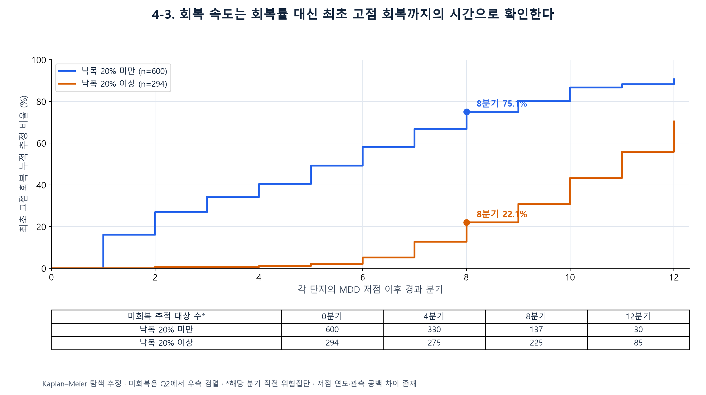

# 추가 분석 — 하락폭이 작은 단지가 더 빨리 회복할까? (Kaplan–Meier)

하락회복률은 회복의 **수준**을 나타낼 뿐 **속도**는 알려주지 않습니다. 그래서 회복 속도를 따로 보기 위해 **MDD 저점 이후 처음으로 기준 고점에 도달한 분기까지의 기간**을 계산했습니다. 기준 시점까지 회복하지 못한 단지를 분석에서 빼면 결과가 치우치므로, 이런 단지는 "아직 회복이 관측되지 않은 상태"로 두는 Kaplan–Meier 생존분석을 사용했습니다.

## 분석 기준

- 전용 60㎡ 이상 85㎡ 미만, 기준 시점 2026년 2분기
- 하락이 관측된 **894개 단지**
- 가격은 단지·분기별 ㎡당 거래가의 중앙값을 사용했고, 거래가 3건 이상인 분기만 포함
- 사건: 저점 이후 처음으로 MDD 구간의 기준 고점 이상인 분기가 관측된 시점
- 검열: 2026년 2분기까지 회복이 관측되지 않은 단지는 우측 검열로 처리

## 결과

| 낙폭 구분 | 표본 | 회복 관측 / 미회복 | 8분기 안에 첫 회복 추정 | 회복기간 중앙값 추정 |
|---|---|---|---|---|
| 낙폭 20% 미만 | 600 | 431 / 169 | 75.1% | 6분기 |
| 낙폭 20% 이상 | 294 | 175 / 119 | 22.1% | 11분기 |

- 이 표본에서는 낙폭이 20% 미만인 단지들이 첫 고점 회복에 더 빨리 도달했습니다.
- **20%라는 기준을 바꿔도 결과가 같은 방향인지** 확인했습니다. 10·15·25%로 나눠도 작은 낙폭 집단의 8분기 내 회복 비율이 더 높았습니다. 수치는 [회복기간_낙폭구분_민감도.csv](회복기간_낙폭구분_민감도.csv)에 있습니다.

  | 기준 | 미만 집단 8분기 회복 | 이상 집단 8분기 회복 |
  |---|---|---|
  | 10% | 93.2% | 39.7% |
  | 15% | 87.8% | 30.9% |
  | 20% | 75.1% | 22.1% |
  | 25% | 64.4% | 13.9% |

- 보조 점검으로, 저점 이후 **8분기 이상 지난 단지만** 따로 셌습니다. 8분기 안에 회복한 비율은 작은 낙폭 집단 258/361개(71.5%), 큰 낙폭 집단 55/256개(21.5%)였습니다. 수치는 [회복기간_8분기추적_민감도.csv](회복기간_8분기추적_민감도.csv)에 있습니다.

## 해석할 때 주의할 점

- 곡선은 "지금 고점 이상인 단지 비율"이 아닙니다. **저점 이후 처음으로 고점을 회복한 단지의 누적 비율 추정치**입니다. 회복한 뒤 다시 떨어진 단지도 회복한 것으로 셉니다.
- 첫 회복은 거래 3건 이상인 분기에서 관측된 시점입니다. 실제 회복은 거래가 없던 분기 사이에 일어났을 수 있습니다.
- 낙폭이 작으면 회복해야 하는 가격 차이도 작습니다. 또한 저점 시기, 상승장에 노출된 기간, 연식이 단지마다 다릅니다. 따라서 이 결과를 인과관계나 미래 예측으로 해석하지 않았습니다.
- 추적 종료 시점이 회복 가능성과 무관하다는 Kaplan–Meier의 가정은 검증하지 않았고, 유의성 검정과 신뢰구간도 산출하지 않은 탐색적 분석입니다.

## 파일

| 파일 | 내용 |
|---|---|
| `build.py` | Kaplan–Meier 추정을 직접 구현한 코드(`km()` 함수). 원래는 발표 4~6번 자료 전체를 만드는 스크립트이며, 이 폴더에는 회복기간 분석 결과만 담았습니다 |
| `회복기간_집단별_요약.csv` | 집단별 4·8·12분기 누적 회복 추정치와 중앙값 |
| `회복기간_KM_위험집단_계산표.csv` | 분기별 위험집단, 사건 수, 검열 수 |
| `회복기간_낙폭구분_민감도.csv` | 10·15·20·25% 기준별 비교 |
| `회복기간_8분기추적_민감도.csv` | 8분기 이상 추적된 단지만 본 보조 점검 |
