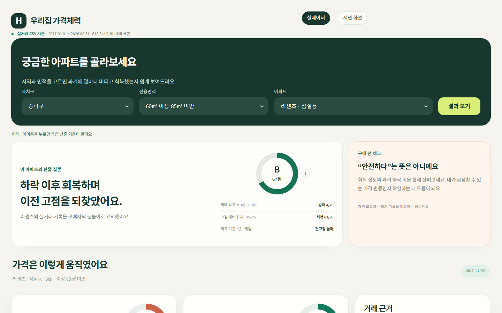
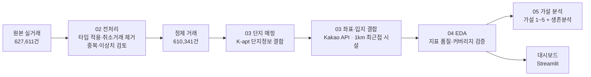
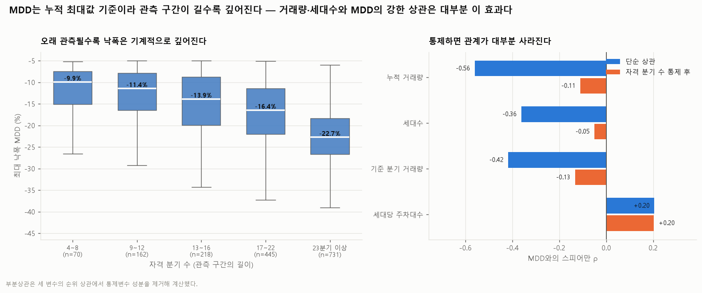
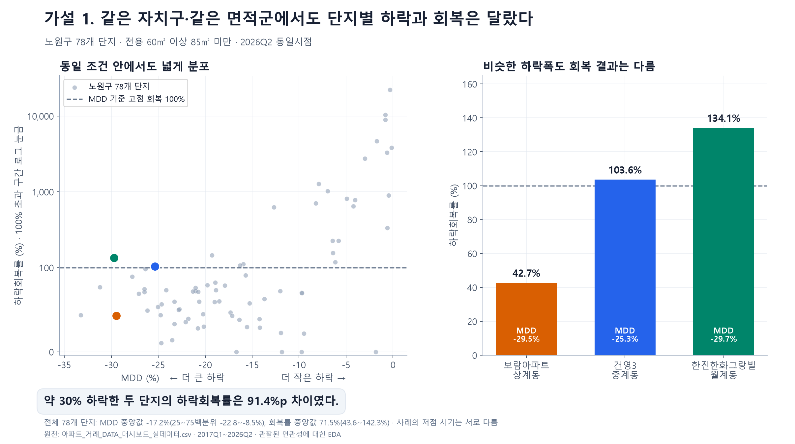
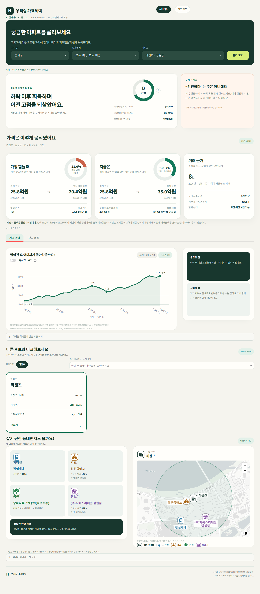

# 서울 아파트 가격 회복탄력성 분석 · 우리집 가격체력

> 서울 아파트 실거래가 61만 건으로 단지별 **하락 방어력(MDD)**과 **회복 수준**을 계산해 비교하는 데이터 분석 프로젝트와 Streamlit 대시보드입니다.



| 항목 | 내용 |
|---|---|
| 유형 | 개인 프로젝트 (기획, 데이터 수집·전처리, 분석, 대시보드 구현까지 1인 진행) |
| 기간 | 2026.08 ~ 2026.09 |
| 데이터 | 서울 아파트 매매 실거래 2017.01~2026.08 · **610,341건 · 25개 자치구 · 8,963개 단지** |
| 기술 | Python · pandas · NumPy · Matplotlib · seaborn · Streamlit · Plotly · pydeck · Kakao Local API |

### ▶ [대시보드 바로 보기](https://apartment-price-dashboard-mt5aymvjdr6uygbknfybvl.streamlit.app/?mode=real)

---

## 1. 문제 정의

서울 아파트 시장은 다시 오르고 있지만, 지역과 단지에 따라 가격이 떨어진 폭과 되돌아온 정도는 다릅니다. 금리와 대출 부담이 큰 상황에서 실수요자에게는 **지금 가격**뿐 아니라 **하락장에서 얼마나 버텼고 이후 얼마나 회복했는지**도 중요합니다. 그런데 기존 부동산 서비스는 현재 가격과 최근 변동 위주라 이런 비교가 어렵습니다.

이 프로젝트는 관심 단지에 대해 세 가지 질문에 답하는 것을 목표로 했습니다.

1. **지금 얼마인가?**
2. **하락장에서 얼마나 버텼는가?** → MDD
3. **이후 얼마나 회복했는가?** → 하락회복률, 고점 대비 위치

## 2. 핵심 지표

| 지표 | 계산 | 의미 |
|---|---|---|
| **MDD** (최대낙폭) | 누적 고점 대비 하락률의 최솟값 | 하락장에서 얼마나 버텼나 |
| **하락회복률** | (현재가 − 저점) ÷ (고점 − 저점) × 100 | 떨어진 만큼 얼마나 되돌아왔나 |
| **고점 대비 위치** | (현재가 ÷ 고점 − 1) × 100 | 이전 고점보다 위인가 아래인가 |

- 가격은 거래마다 **㎡당 가격**을 먼저 계산한 뒤, **단지 × 면적군 × 분기** 단위의 중앙값을 사용했습니다.
- 거래가 3건 미만인 분기는 대표 가격이 흔들리므로 제외했습니다. 지표는 3건 이상인 분기가 4개 이상인 단지에만 계산했습니다.

## 3. 데이터

| 데이터 | 출처 | 주요 내용 |
|---|---|---|
| 아파트 매매 실거래가 | 국토교통부 실거래가 공개시스템 | 단지명, 면적, 거래금액, 계약일, 층, 해제사유 등 20개 열 |
| 공동주택 단지 기본정보 | 공동주택관리정보시스템(K-apt) | KAPT 단지코드, 세대수, 건축연도, 주차대수, 복도유형 |
| 지하철역 위치 | 서울 열린데이터광장 · 서울시 역사마스터 정보 | 역명, 노선, 좌표 (655개) |
| 공원 위치 | 서울 열린데이터광장 · 서울시 주요 공원현황 | 공원명, 좌표 (133개) |
| 학교 위치 | 공공데이터포털 · 서울특별시교육청_학교별 현황 정보 | 학교명, 학교급, 주소, 좌표 (1,313개) |
| 대규모점포 위치 | <!-- 확인 필요 --> | 점포명, 좌표 (644개) |
| 주소 좌표 | Kakao Local API | 도로명주소 → 위도·경도 |

> 원본과 중간 산출물은 약 4GB라 저장소에 포함하지 않았습니다. 데이터 구조는 [샘플 100행](00_기획/샘플데이터/)에서 볼 수 있습니다.

## 4. 분석 과정



### 02. 거래 데이터 전처리 — [통합 결과 보고서](02_거래전처리/거래_DATA_전처리_통합결과보고서.md)

| 단계 | 결과 |
|---|---|
| 타입 진단·적용 | 20개 열을 날짜·기간·nullable 정수·범주형으로 변환, 변환 실패 0건. 본번·부번은 앞자리 0 보존을 위해 문자열로 유지 |
| 취소 거래 제거 | `해제사유발생일`이 있는 **17,270건(2.75%)** 제거 |
| 중복 검토 | 핵심키가 같지만 세부정보가 다른 47개 그룹을 하나씩 검토. 실제로 다른 거래일 가능성이 있어 **자동 삭제 0건** |
| 품질 이상 | 조건부 가격 이상치 20건, 건축연도 역전 39건은 원본 유지. 도로명 결측 205건만 보완 |

**"확실하지 않으면 지우지 않는다"**는 원칙을 세우고, 삭제하지 않은 이유를 보고서에 남겼습니다.

### 03. 단지 매핑과 입지 결합 — [보고서 모음](03_단지매핑_입지결합/보고서/)

- **단지 매핑**: 도로명주소·법정동주소·단지명이 **정확히 일치**할 때만 연결했습니다. 유사도 매칭은 쓰지 않았고, 동점 후보가 있으면 매핑하지 않았습니다. 그 결과 거래 행 기준 매칭률은 **86.2%**입니다.
- **지오코딩**: Kakao 주소 검색 API로 좌표를 붙였습니다. 좌표를 받지 못한 거래는 **65건(10개 주소)**이었고, 대부분 재건축으로 지도 DB에서 빠진 노후 단지였습니다.
- **입지 결합**: Haversine 거리로 학교·지하철·공원·대규모점포별 **1km 안의 최근접 시설 1곳**을 연결했습니다.

### 04. EDA — [대시보드 지표 EDA](04_EDA/EDA_대시보드_지표/README.md) · [거래 데이터 EDA (PDF)](04_EDA/eda/아파트_거래_EDA_REPORT.pdf)

지표를 대시보드에 올리기 전에 **지표 자체가 믿을 만한지**를 먼저 검증했습니다. 이 과정에서 발견한 문제를 대시보드 설계에 반영했습니다.

| 발견 | 대응 |
|---|---|
| 하락회복률 최댓값이 **2,718,940%**. 낙폭이 얕으면 분모(고점 − 저점)가 0에 가까워져 값이 발산 | 대시보드 등급의 회복 축을 **고점 대비 위치**로 교체. 가설 분석은 낙폭 5% 이상 단지로 제한 |
| 거래량·세대수와 MDD의 강한 상관(ρ = −0.56, −0.36)은 **관측 기간이 길수록 MDD가 깊어지는 효과** 때문. 관측 기간을 통제하면 −0.11, −0.05로 약해짐 | 이후 가설 분석에서 **유효 분기 수를 보정**하고 해석 |
| 지표를 계산할 수 있는 단지×면적 조합은 **15.1%**. 다만 거래량 기준으로는 60.2% | 지표를 못 내는 조합에는 실제 거래 기록만 보여주는 **대체 화면**을 설계 |



### 05. 가설 분석 — [발표 자료](05_발표자료/)

**공통 조건**: 전용 60~85㎡, 기준 시점 2026년 2분기, 하락이 관측된 894개 단지 중 낙폭 5% 이상 722개

| 가설 | 결과 |
|---|---|
| **1.** 같은 자치구·면적군이면 하락과 회복도 비슷할까? | **아니다.** 노원구 78개 단지의 회복률 사분위 범위가 43.6~142.3%. 낙폭이 거의 같은 두 단지(−29.5%, −29.7%)의 회복률 차이가 **91.4%p** |
| **2.** 거래가 활발한 단지가 더 잘 버티고 회복할까? | 관측 기간을 보정하면 상관이 −0.13~+0.09로 약함. 방어와 회복의 방향도 엇갈림 |
| **3-1.** 대단지가 더 잘 버티고 회복할까? | 1,000세대 이상은 방어 −3.8%p, 회복 +2.9%p로 **두 지표가 반대 방향** |
| **3-2.** 신축이 더 잘 버티고 회복할까? | 연식 순서에 따른 일관된 우위 없음 |
| **4.** 교통·생활시설이 가까우면 유리할까? | 자치구와 관측 기간을 보정한 상관의 절댓값이 최대 **0.105**. 거리만으로는 설명력이 작음 |
| **5.** 여러 특성을 함께 넣으면 설명될까? | 설명력(R²) 개선이 MDD +0.014, 회복률 +0.007에 그침. **단지별 차이가 대부분 설명되지 않고 남음** |



**추가 분석 — 회복 속도 (Kaplan–Meier)**: 회복률은 수준만 보여주므로, 저점 이후 첫 고점 회복까지의 기간을 생존분석으로 따로 추정했습니다. 8분기 안에 첫 회복에 도달한 비율은 낙폭 20% 미만 단지가 **75.1%**, 20% 이상 단지가 **22.1%**였습니다. 기준을 10·15·25%로 바꿔도 같은 방향이었습니다. → [상세](05_발표자료/추가분석_회복기간_생존분석/)

> 모든 결과는 관찰된 연관성에 대한 **탐색적 분석(EDA)**입니다. 인과관계나 미래 가격 예측을 검증한 것이 아닙니다.

## 5. 결론 → 서비스로

같은 자치구, 같은 면적군에서도 단지마다 하락과 회복이 크게 달랐습니다. 거래량, 규모, 연식, 입지 같은 몇 가지 특성으로는 이 차이를 설명하기 어려웠습니다. 그래서 **자치구 평균이나 단지 특성으로 짐작하는 대신, 관심 단지의 실제 가격 흐름을 직접 비교하는 도구**가 필요하다고 판단해 대시보드를 만들었습니다.

## 6. 대시보드 — 우리집 가격체력 · [상세 README](대시보드/README.md)

- 자치구 → 면적 → 단지를 선택하면 **한 줄 결론, 등급, 가격 흐름, MDD, 고점 대비 위치, 회복 기간**을 보여줍니다.
- **등급**은 같은 면적군 안에서 방어(MDD) 20점과 회복(고점 대비 위치) 80점의 순위로 매깁니다.
- 최대 3개 단지를 같은 기준으로 비교하고, 단지 분포 탭에서 선택한 단지가 구·면적군 안에서 어디쯤인지 봅니다.
- 1km 안의 최근접 지하철, 학교, 공원, 대규모점포를 지도와 함께 표시합니다.
- 테스트: 계산과 화면 동작을 검증하는 unittest 70개, Playwright로 데스크톱·모바일 화면 검증

<details>
<summary>전체 화면 보기</summary>



</details>

### 실행

```powershell
pip install -r 대시보드/requirements.txt
python -m streamlit run 대시보드/streamlit_app.py
```

실데이터 파일(약 95MB)은 저장소에 없으므로, 화면 상단의 **시연 화면**을 선택하거나 `http://localhost:8501/?mode=demo`로 접속하세요. 실데이터 화면은 [배포된 대시보드](https://apartment-price-dashboard-mt5aymvjdr6uygbknfybvl.streamlit.app/?mode=real)에서 볼 수 있습니다.

## 7. 한계와 개선 방향

- **표본 커버리지**: 거래가 적은 단지가 많아, 지표를 낼 수 있는 조합이 15.1%에 그칩니다. 분기 대신 반기 단위로 집계하거나 인접 면적군을 합치는 방안을 검토할 수 있습니다.
- **회복률 지표의 불안정성**: 얕은 낙폭에서 값이 발산합니다. 대시보드는 고점 대비 위치로 대체했지만, 서비스 지표로 쓰려면 정의를 더 다듬어야 합니다.
- **입지 변수의 해상도**: 직선거리만으로는 노선, 학군, 시설 품질을 담지 못합니다. 도보 시간이나 시설 등급을 추가할 수 있습니다.
- **통계적 검증**: 유의성 검정, 신뢰구간, 인과 추론은 하지 않았습니다.

## 폴더 구조

```
├─ 00_기획/                  프로젝트 설명, 기획서(PDF), 샘플 데이터, 대시보드 초기 스크린샷
├─ 01_원천데이터/            원본 중복 분석 보고서
├─ 02_거래전처리/            단계별 전처리 코드와 결과 보고서
├─ 03_단지매핑_입지결합/     단지 매핑, 지오코딩, 입지 결합 코드와 보고서
├─ 04_EDA/                   지표 검증 EDA 코드, 차트, 보고서
├─ 05_발표자료/              최종 발표 이미지, 가설 분석 코드, 예상 질문과 답변, 생존분석
├─ 대시보드/                 Streamlit 앱, 테스트
└─ images/                   README용 이미지
```
